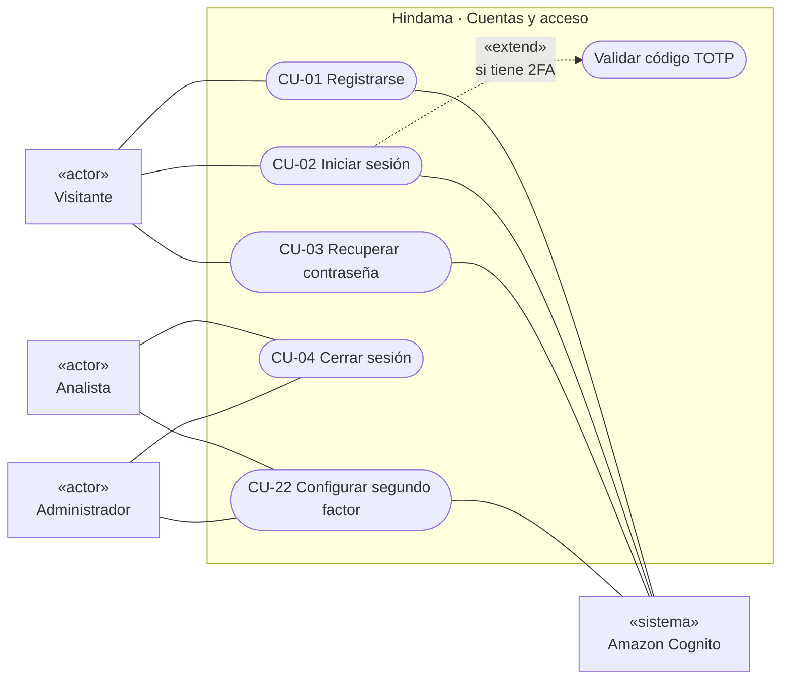
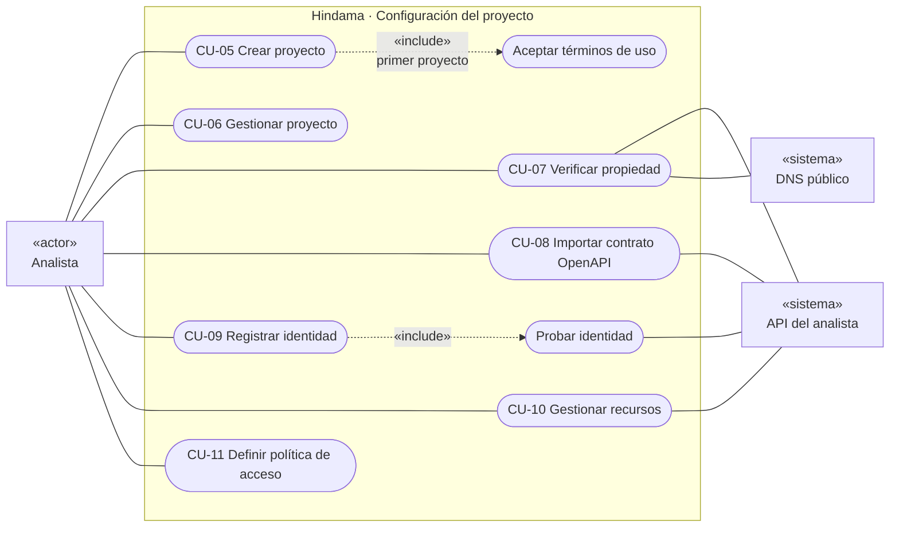
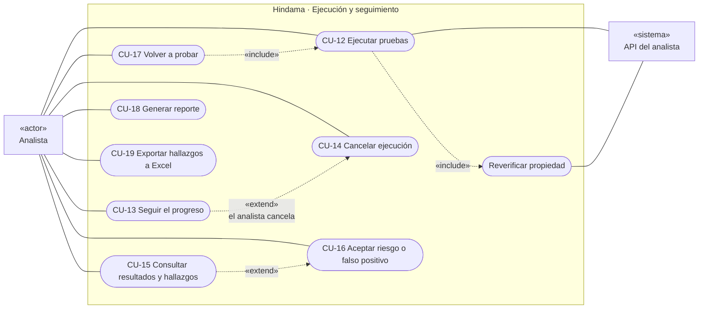
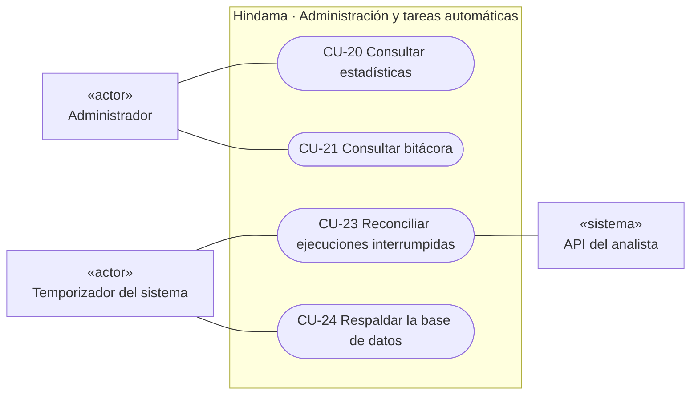
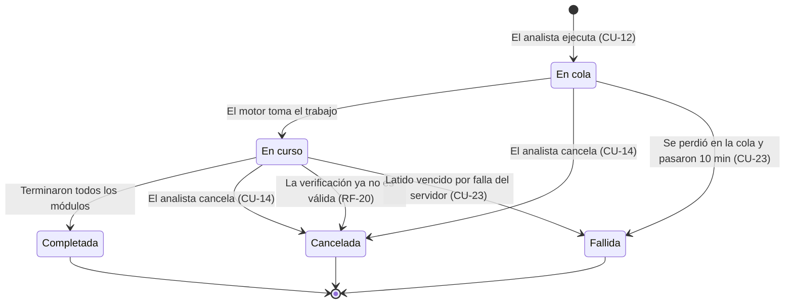
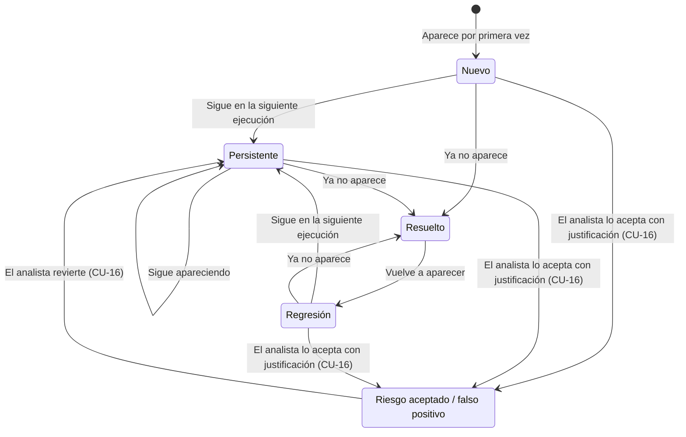
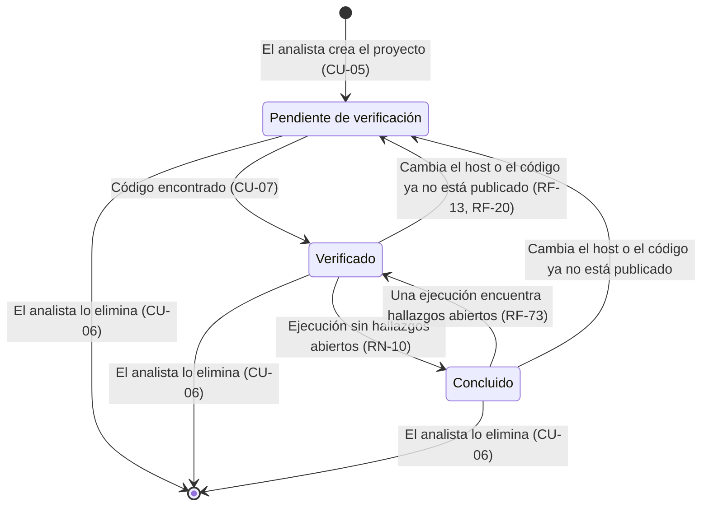
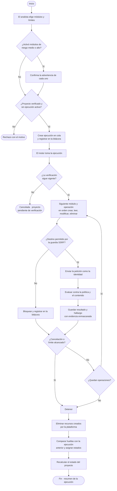
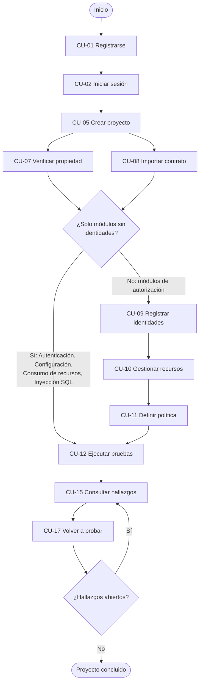

# Casos de uso — Hindama v1.0

Este documento describe cómo interactúan los usuarios y los sistemas externos con Hindama. Cada caso de uso (CU-nn) se deriva de una funcionalidad del [documento de requerimientos](requerimientos.md) y cita los requerimientos funcionales (RF), reglas de negocio (RN) y no funcionales (RNF) que lo rigen. Los detalles técnicos de cada flujo están en la [arquitectura](../01-arquitectura/arquitectura.md).

## 1. Actores

| Actor | Tipo | Descripción |
| --- | --- | --- |
| **Visitante** | Humano, principal | Persona sin sesión. Puede registrarse, iniciar sesión y recuperar su contraseña. |
| **Analista** | Humano, principal | Usuario registrado que prueba sus propias APIs. Solo accede a sus propios proyectos (RN-02). |
| **Administrador** | Humano, principal | Integrante del equipo de Hindama. Consulta estadísticas agregadas y la bitácora; nunca el contenido de los proyectos (RN-03). |
| **Amazon Cognito** | Sistema externo, secundario | Registra usuarios, autentica, envía correos de verificación y recuperación, y gestiona el segundo factor. |
| **API del analista** | Sistema externo, secundario | La API que se prueba. Responde a la verificación de propiedad, al descubrimiento de recursos y a las pruebas. Es no confiable. |
| **DNS público** | Sistema externo, secundario | Resuelve los destinos y responde los registros TXT de verificación. |
| **Temporizador del sistema** | Sistema interno, principal | Dispara tareas automáticas: la limpieza de ejecuciones interrumpidas y el respaldo diario. |

## 2. Diagramas de casos de uso

Los diagramas siguen la notación UML de casos de uso: los actores están a los lados, los casos de uso en el centro dentro del límite del sistema, y las flechas punteadas marcan las relaciones «include» (siempre ocurre) y «extend» (ocurre solo en ciertas condiciones).

### 2.1 Cuentas y acceso

Al iniciar sesión, el Visitante pasa a ser Analista o Administrador según su grupo en Cognito.

### 2.2 Configuración del proyecto

### 2.3 Ejecución y seguimiento

### 2.4 Administración y tareas automáticas

## 3. Lista de casos de uso

| ID | Caso de uso | Actor principal | Funcionalidad | Requerimientos | Prioridad |
| --- | --- | --- | --- | --- | --- |
| CU-01 | Registrarse | Visitante | F-01 | RF-01, RF-02, RF-03 | Alta |
| CU-02 | Iniciar sesión | Visitante | F-01 | RF-04, RF-06, RF-07, RF-08 | Alta |
| CU-03 | Recuperar contraseña | Visitante | F-01 | RF-05 | Alta |
| CU-04 | Cerrar sesión | Analista, Administrador | F-01 | RF-04, RF-08 | Alta |
| CU-05 | Crear proyecto | Analista | F-02 | RF-10, RF-11, RF-16 | Alta |
| CU-06 | Gestionar proyecto | Analista | F-02 | RF-12, RF-13, RF-14, RF-15 | Alta |
| CU-07 | Verificar propiedad | Analista | F-03 | RF-17 a RF-21 | Alta |
| CU-08 | Importar contrato OpenAPI | Analista | F-04 | RF-22 a RF-27 | Alta |
| CU-09 | Registrar identidad | Analista | F-05 | RF-28 a RF-34 | Alta |
| CU-10 | Gestionar recursos | Analista | F-06 | RF-35 a RF-38 | Alta |
| CU-11 | Definir política de acceso | Analista | F-07 | RF-39 a RF-43 | Alta |
| CU-12 | Ejecutar pruebas | Analista | F-08, F-09 | RF-44 a RF-62 | Alta |
| CU-13 | Seguir el progreso | Analista | F-08 | RF-51 | Alta |
| CU-14 | Cancelar ejecución | Analista | F-08 | RF-52 | Alta |
| CU-15 | Consultar resultados y hallazgos | Analista | F-10 | RF-63 a RF-67 | Alta |
| CU-16 | Aceptar riesgo o falso positivo | Analista | F-11 | RF-69, RF-70 | Alta |
| CU-17 | Volver a probar | Analista | F-11 | RF-68, RF-71, RF-72, RF-73 | Alta |
| CU-18 | Generar reporte | Analista | F-12 | RF-74, RF-75, RF-76 | Media |
| CU-19 | Exportar hallazgos a Excel | Analista | F-12 | RF-77 | Media |
| CU-20 | Consultar estadísticas | Administrador | F-13 | RF-78, RF-79, RF-80 | Baja |
| CU-21 | Consultar bitácora | Administrador | F-14 | RF-81 a RF-84 | Media |
| CU-22 | Configurar segundo factor | Analista, Administrador | F-15 | RF-85, RF-86, RF-87 | Baja |
| CU-23 | Reconciliar ejecuciones interrumpidas | Temporizador del sistema | F-08 | RF-52, RNF-18 | Alta |
| CU-24 | Respaldar la base de datos | Temporizador del sistema | — | RNF-17 | Media |

## 4. Especificación de los casos de uso

Convenciones: en los flujos, «el sistema» es Hindama. Los flujos alternos (A) son caminos válidos distintos al principal; las excepciones (E) son errores. Todos los casos de uso del Analista y del Administrador tienen como precondición una sesión iniciada, salvo que se indique lo contrario, y toda petición que modifica datos lleva token anti-CSRF (RNF-07).

### Cuentas y acceso

#### CU-01 Registrarse

| Campo | Detalle |
| --- | --- |
| Actor principal | Visitante |
| Actores secundarios | Amazon Cognito |
| Objetivo | Crear una cuenta de analista. |
| Precondiciones | Ninguna. |
| Postcondiciones | Existe una cuenta verificada con rol de analista. |
| Requerimientos | RF-01, RF-02, RF-03 |

**Flujo principal**

1. El Visitante elige «Crear cuenta».
2. El sistema muestra el formulario: nombre, correo y contraseña, con la política de contraseñas visible.
3. El Visitante llena el formulario y lo envía.
4. El sistema registra la cuenta en Cognito, que envía un código de verificación al correo.
5. El Visitante introduce el código.
6. El sistema confirma la cuenta y la deja activa con rol de analista (RF-01, RF-02).
7. El sistema lo lleva a iniciar sesión.

**Flujos alternos**

- **A1. No llegó el código (paso 5):** el Visitante pide reenviarlo; Cognito envía uno nuevo.

**Excepciones**

- **E1. Contraseña débil (paso 4):** el sistema indica qué regla no se cumple (RF-03) y conserva los demás datos.
- **E2. Correo ya registrado (paso 4):** el sistema muestra un mensaje genérico que no confirma si el correo existe y sugiere iniciar sesión o recuperar la contraseña.
- **E3. Código incorrecto o vencido (paso 6):** el sistema lo indica y permite reenviarlo.

#### CU-02 Iniciar sesión

| Campo | Detalle |
| --- | --- |
| Actor principal | Visitante |
| Actores secundarios | Amazon Cognito |
| Objetivo | Acceder a la plataforma. |
| Precondiciones | Cuenta verificada. |
| Postcondiciones | Sesión iniciada en una cookie HttpOnly cifrada; el usuario ve su pantalla inicial según su rol. |
| Requerimientos | RF-04, RF-06, RF-07, RF-08 |

**Flujo principal**

1. El Visitante abre «Iniciar sesión».
2. El Visitante introduce correo y contraseña.
3. El sistema autentica con Cognito.
4. El sistema guarda la sesión en una cookie HttpOnly, Secure y cifrada; los tokens nunca llegan al navegador (RF-08).
5. El sistema consulta el rol y redirige: el Analista a su lista de proyectos, el Administrador al panel de administración.

**Flujos alternos**

- **A1. Segundo factor activo (paso 3):** el sistema pide el código TOTP de 6 dígitos y lo valida con Cognito antes de continuar (F-15).

**Excepciones**

- **E1. Credenciales incorrectas (paso 3):** mensaje genérico que no revela si el correo existe (RF-06).
- **E2. Demasiados intentos fallidos:** Cognito bloquea la cuenta temporalmente; el sistema lo informa sin dar detalles adicionales (RF-06).
- **E3. Cuenta sin verificar:** el sistema ofrece reenviar el código de verificación.

#### CU-03 Recuperar contraseña

| Campo | Detalle |
| --- | --- |
| Actor principal | Visitante |
| Actores secundarios | Amazon Cognito |
| Objetivo | Definir una contraseña nueva. |
| Precondiciones | Ninguna. |
| Postcondiciones | La contraseña cambió; las sesiones anteriores dejan de renovarse. |
| Requerimientos | RF-05, RF-03 |

**Flujo principal**

1. El Visitante elige «Olvidé mi contraseña» e introduce su correo.
2. El sistema muestra siempre el mismo mensaje: «Si el correo está registrado, recibirás un código».
3. Cognito envía el código al correo.
4. El Visitante introduce el código y la contraseña nueva.
5. El sistema cambia la contraseña y lo lleva a iniciar sesión.

**Excepciones**

- **E1. Código incorrecto o vencido (paso 5):** el sistema lo indica y permite pedir otro.
- **E2. Contraseña nueva débil (paso 5):** el sistema indica qué regla no se cumple.

#### CU-04 Cerrar sesión

| Campo | Detalle |
| --- | --- |
| Actor principal | Analista o Administrador |
| Actores secundarios | Amazon Cognito |
| Objetivo | Terminar la sesión. |
| Postcondiciones | Cookie eliminada y token de renovación revocado. |
| Requerimientos | RF-04 |

**Flujo principal**

1. El usuario elige «Cerrar sesión».
2. El sistema revoca el token de renovación en Cognito y elimina la cookie (RF-04).
3. El sistema lo lleva a la página de inicio.

**Excepciones**

- **E1. Cognito no responde (paso 2):** el sistema elimina la cookie de todos modos e informa que la sesión se cerró en este navegador.

#### CU-22 Configurar segundo factor

| Campo | Detalle |
| --- | --- |
| Actor principal | Analista o Administrador |
| Actores secundarios | Amazon Cognito |
| Objetivo | Activar o desactivar el código TOTP. |
| Postcondiciones | El segundo factor queda activo o inactivo en la cuenta. |
| Requerimientos | RF-85, RF-86, RF-87 |

**Flujo principal (activar)**

1. El usuario abre su perfil y elige «Activar 2FA».
2. El sistema muestra un código QR generado con Cognito.
3. El usuario lo escanea con su aplicación e introduce el código de 6 dígitos.
4. El sistema valida el código y activa el segundo factor (RF-85).

**Flujos alternos**

- **A1. Desactivar:** el usuario elige «Desactivar 2FA»; el sistema pide un código TOTP válido antes de desactivarlo (RF-87).

**Excepciones**

- **E1. Código incorrecto (paso 4):** el sistema lo indica; el segundo factor no se activa.
- **E2. Administrador intenta desactivarlo:** el sistema lo impide, porque es obligatorio para administradores (RF-86).

### Configuración del proyecto

#### CU-05 Crear proyecto

| Campo | Detalle |
| --- | --- |
| Actor principal | Analista |
| Objetivo | Registrar una API para probarla. |
| Postcondiciones | Proyecto creado en estado «Pendiente de verificación» y registrado en la bitácora. |
| Requerimientos | RF-10, RF-11, RF-16 |
| Reglas | RN-12 |

**Flujo principal**

1. El Analista elige «Nuevo proyecto».
2. El sistema verifica que el Analista ya aceptó los términos de uso.
3. El Analista introduce nombre, descripción y URL base.
4. El sistema valida los datos y la URL base (RF-10, RF-11).
5. El sistema crea el proyecto en estado «Pendiente de verificación» y genera su código de verificación.
6. El sistema lo lleva a importar el contrato (CU-08) y a verificar la propiedad (CU-07).

**Flujos alternos**

- **A1. Primer proyecto (paso 2):** el sistema muestra los términos de uso responsable; el Analista los acepta y el sistema registra la fecha (RF-16, RN-12).

**Excepciones**

- **E1. No acepta los términos (A1):** el sistema no crea el proyecto.
- **E2. Datos inválidos (paso 4):** nombre vacío o demasiado largo, o descripción demasiado larga; el sistema señala el campo.
- **E3. URL no permitida (paso 4):** formato inválido, esquema distinto de HTTP o HTTPS, o destino privado, de loopback, de enlace local o de metadatos de nube; el sistema indica el motivo (RF-11).
- **E4. URL con HTTP (paso 4):** el sistema acepta, pero advierte que el tráfico y las credenciales de prueba viajarán sin cifrar.

#### CU-06 Gestionar proyecto

| Campo | Detalle |
| --- | --- |
| Actor principal | Analista |
| Objetivo | Consultar, editar o eliminar sus proyectos. |
| Precondiciones | El proyecto pertenece al Analista. |
| Postcondiciones | El proyecto se consultó, cambió o eliminó. |
| Requerimientos | RF-12, RF-13, RF-14, RF-15 |
| Reglas | RN-02 |

**Flujo principal (consultar)**

1. El Analista abre «Mis proyectos».
2. El sistema muestra solo sus proyectos, con estado de verificación, última ejecución y hallazgos abiertos (RF-12).
3. El Analista abre un proyecto.
4. El sistema muestra el dashboard del proyecto: verificación, módulos disponibles, última ejecución y hallazgos abiertos por severidad (RF-15).

**Flujos alternos**

- **A1. Editar:** el Analista cambia nombre o descripción y guarda. Si cambia el host de la URL base, el proyecto vuelve a «Pendiente de verificación» (RF-13).
- **A2. Eliminar:** el Analista elige «Eliminar» y escribe el nombre del proyecto para confirmar; el sistema borra el proyecto y todo lo que contiene, y lo registra en la bitácora (RF-14).

**Excepciones**

- **E1. Proyecto ajeno o inexistente:** el sistema responde «no encontrado», sin revelar si existe (RN-02, RNF-05).
- **E2. Ejecución activa al eliminar (A2):** el sistema pide cancelarla primero.

#### CU-07 Verificar propiedad

| Campo | Detalle |
| --- | --- |
| Actor principal | Analista |
| Actores secundarios | API del analista, DNS público |
| Objetivo | Demostrar que el Analista controla el host de su API. |
| Precondiciones | Proyecto en estado «Pendiente de verificación». |
| Postcondiciones | Proyecto «Verificado» y registrado en la bitácora; se habilitan las pruebas. |
| Requerimientos | RF-17, RF-18, RF-19, RF-20, RF-21 |
| Reglas | RN-01 |

**Flujo principal**

1. El Analista abre «Verificar propiedad».
2. El sistema muestra el código del proyecto y los dos métodos: archivo en `/.well-known/hindama-verificacion.txt` o registro TXT en `_hindama-verificacion.<host>`.
3. El Analista publica el código con el método que prefiera y elige «Verificar».
4. El sistema consulta el archivo o el registro TXT a través de la guardia SSRF.
5. El código coincide: el sistema marca el proyecto como «Verificado» y lo registra en la bitácora.

**Excepciones**

- **E1. Archivo no encontrado, contenido distinto, registro TXT ausente o error de conexión (paso 4):** el sistema indica la causa exacta y cómo corregirla (RF-21).
- **E2. El host resuelve a una dirección no permitida (paso 4):** el sistema bloquea la consulta, lo registra en la bitácora como «bloqueo por destino no permitido» y lo informa.

El diagrama de secuencia detallado está en la [arquitectura, sección 4.2](../01-arquitectura/arquitectura.md#42-verificación-de-propiedad).

#### CU-08 Importar contrato OpenAPI

| Campo | Detalle |
| --- | --- |
| Actor principal | Analista |
| Actores secundarios | API del analista (si el contrato se importa por URL) |
| Objetivo | Cargar el contrato del que se generan las pruebas. |
| Postcondiciones | Nueva versión del contrato guardada con sus operaciones. |
| Requerimientos | RF-22, RF-23, RF-24, RF-25, RF-26, RF-27 |

**Flujo principal**

1. El Analista elige «Importar contrato» y sube un archivo JSON o YAML, o escribe la URL del contrato.
2. El sistema valida que sea OpenAPI 3.0 o 3.1 y resuelve las referencias internas (RF-22, RF-23).
3. El sistema extrae las operaciones: método, ruta, parámetros, esquemas y seguridad declarada (RF-24).
4. El sistema muestra la lista de operaciones y los avisos de lo que no pudo interpretar.
5. El sistema guarda la versión del contrato.

**Flujos alternos**

- **A1. Ya había un contrato (paso 5):** el sistema muestra las operaciones agregadas, modificadas y eliminadas respecto a la versión anterior (RF-26).
- **A2. Servidores distintos (paso 4):** si los servidores declarados no coinciden con la URL base, el sistema advierte que siempre usará la URL base del proyecto (RF-27).

**Excepciones**

- **E1. Documento inválido (paso 2):** el sistema rechaza la importación e indica la línea o el campo con error (RF-25).
- **E2. Swagger 2 (paso 2):** el sistema indica que esa versión no está soportada (RF-25).
- **E3. Archivo mayor a 5 MB, o URL inaccesible o no permitida (paso 1):** el sistema lo rechaza e indica el motivo.
- **E4. Referencias externas (paso 2):** el sistema no las sigue y las muestra como aviso (RF-23).

#### CU-09 Registrar identidad

| Campo | Detalle |
| --- | --- |
| Actor principal | Analista |
| Actores secundarios | API del analista |
| Objetivo | Registrar una cuenta de prueba de la API del analista. |
| Precondiciones | Contrato importado (para el login automático). |
| Postcondiciones | Identidad guardada con su credencial cifrada; registrada en la bitácora. |
| Requerimientos | RF-28 a RF-34 |
| Reglas | RN-11 |

**Flujo principal**

1. El Analista elige «Agregar identidad» e indica nombre y rol en su API (RF-28).
2. El Analista elige la forma de autenticación: login automático, token Bearer, cookie de sesión o cabecera personalizada (RF-29).
3. El Analista introduce la credencial.
4. El sistema prueba la credencial con una petición a una operación protegida.
5. La prueba funciona: el sistema cifra y guarda la credencial, y desde ese momento solo muestra sus últimos 4 caracteres (RF-31).

**Flujos alternos**

- **A1. Login automático (paso 2):** el sistema propone el endpoint de login detectado en el contrato; el Analista lo confirma o elige otro (RF-30).

**Excepciones**

- **E1. La prueba falla (paso 4):** el sistema muestra el código de estado recibido, sin exponer la credencial (RF-32); el Analista puede corregirla o guardarla de todos modos.

La identidad anónima existe siempre y no se registra (RF-34).

#### CU-10 Gestionar recursos

| Campo | Detalle |
| --- | --- |
| Actor principal | Analista |
| Actores secundarios | API del analista |
| Objetivo | Registrar qué objetos de la API pertenecen a cada identidad. |
| Precondiciones | Proyecto verificado, contrato importado y al menos una identidad. |
| Postcondiciones | Recursos registrados por identidad. |
| Requerimientos | RF-35, RF-36, RF-37, RF-38 |

**Flujo principal**

1. El Analista abre «Recursos» y revisa los parámetros que el sistema identificó como identificadores de recursos (RF-35).
2. El Analista elige «Descubrir recursos».
3. El sistema llama, como cada identidad, solo a operaciones GET de listado (RF-36).
4. El sistema muestra los recursos encontrados por identidad.
5. El Analista los confirma.

**Flujos alternos**

- **A1. Registro manual:** el Analista agrega, edita o elimina recursos indicando tipo, identificador e identidad propietaria (RF-37).

**Excepciones**

- **E1. Identidad sin recursos (paso 4):** el sistema advierte que el módulo de acceso a objetos no podrá probarla (RF-38).
- **E2. Proyecto no verificado (paso 2):** el sistema no permite descubrir recursos, porque implica enviar peticiones (RN-01).

#### CU-11 Definir política de acceso

| Campo | Detalle |
| --- | --- |
| Actor principal | Analista |
| Objetivo | Declarar quién debería poder ejecutar cada operación. |
| Precondiciones | Contrato importado. |
| Postcondiciones | Política confirmada; los módulos de autorización quedan disponibles. |
| Requerimientos | RF-39, RF-40, RF-41, RF-42, RF-43 |
| Reglas | RN-08 |

**Flujo principal**

1. El Analista abre «Política».
2. El sistema muestra cada operación con una plantilla propuesta: pública, cualquier autenticado, solo propietario, propietario o administrador, o solo administrador (RF-39, RF-40).
3. El Analista acepta o cambia cada plantilla.
4. Para las plantillas con propiedad, el Analista indica el campo que identifica al propietario (RF-41).
5. El Analista guarda. El sistema registra quién y cuándo la modificó (RF-43).

**Flujos alternos**

- **A1. Edición en bloque (paso 3):** el Analista aplica una plantilla a todas las operaciones de una ruta (RF-42).

**Excepciones**

- **E1. Plantilla de propiedad sin campo de propietario (paso 5):** el sistema no permite guardar esa operación hasta que se indique.

Las propuestas que el Analista no confirma no se usan en las pruebas (RN-08).

### Ejecución y seguimiento

#### CU-12 Ejecutar pruebas

| Campo | Detalle |
| --- | --- |
| Actor principal | Analista |
| Actores secundarios | API del analista |
| Objetivo | Ejecutar uno o varios módulos de prueba sobre la API. |
| Precondiciones | Proyecto verificado y sin otra ejecución activa. |
| Postcondiciones | Ejecución terminada (completada, cancelada o fallida) con sus resultados y hallazgos; registrada en la bitácora. |
| Requerimientos | RF-44 a RF-62 |
| Reglas | RN-01, RN-05, RN-06, RN-07 |

**Flujo principal**

1. El Analista elige un módulo o «Prueba completa».
2. El sistema muestra los módulos con su disponibilidad; los que no cumplen requisitos aparecen deshabilitados con lo que falta (RF-45).
3. El Analista activa o desactiva módulos y ajusta los límites (RF-44, RF-47).
4. El Analista elige «Ejecutar».
5. El sistema crea la ejecución en cola y la registra en la bitácora.
6. El sistema vuelve a verificar la propiedad (RF-20).
7. Por cada módulo y operación, el sistema envía las peticiones como cada identidad, en orden crear, leer, modificar y eliminar, y evalúa cada respuesta contra la política y su contenido (RF-49, RF-61).
8. El sistema registra resultados y hallazgos con evidencia enmascarada (RF-62).
9. El sistema elimina los recursos que creó (RN-06).
10. El sistema compara los hallazgos con la ejecución anterior, asigna estados y muestra el resumen.

**Flujos alternos**

- **A1. Módulos de riesgo medio o alto (paso 3):** el Analista los activa y el sistema exige confirmar una advertencia por cada uno (RN-05, RF-46).
- **A2. El Analista cancela (pasos 6–9):** se ejecuta CU-14.

**Excepciones**

- **E1. Ya hay una ejecución activa (paso 5):** el sistema lo indica y no crea otra (RN-07).
- **E2. La verificación ya no es válida (paso 6):** el sistema cancela la ejecución y devuelve el proyecto a «Pendiente de verificación» (RF-20).
- **E3. Destino no permitido (paso 7):** la guardia SSRF bloquea la petición y lo registra en la bitácora (RF-50).
- **E4. Credencial vencida (paso 7):** el sistema marca la identidad como «Credencial vencida», omite sus pruebas restantes y lo informa (RF-33).
- **E5. Se alcanza un límite de peticiones o de duración (paso 7):** el sistema detiene la ejecución y conserva los resultados parciales (RF-47).
- **E6. Falla del servidor:** la ejecución queda como «Fallida»; la reconcilia CU-23.

El diagrama de actividad está en la sección 5.4 y el de secuencia en la [arquitectura, sección 4.3](../01-arquitectura/arquitectura.md#43-ejecución-de-pruebas-de-principio-a-fin-con-progreso-por-sse).

#### CU-13 Seguir el progreso

| Campo | Detalle |
| --- | --- |
| Actor principal | Analista |
| Objetivo | Ver el avance de una ejecución en tiempo real. |
| Precondiciones | Ejecución en cola o en curso, propia del Analista. |
| Requerimientos | RF-51, RNF-03 |

**Flujo principal**

1. Al lanzar una ejecución, el sistema abre la vista de progreso.
2. El sistema muestra el módulo en curso, las peticiones enviadas, el porcentaje y los hallazgos encontrados, con un retraso menor a 2 segundos (RF-51, RNF-03).
3. Al terminar, el sistema muestra el resumen (CU-15).

**Flujos alternos**

- **A1. Se pierde la conexión:** el navegador se reconecta y el sistema muestra el estado actual sin perder información.
- **A2. El Analista cierra la vista:** la ejecución continúa; puede volver desde el dashboard del proyecto.

#### CU-14 Cancelar ejecución

| Campo | Detalle |
| --- | --- |
| Actor principal | Analista |
| Objetivo | Detener una ejecución en curso. |
| Precondiciones | Ejecución en cola o en curso, propia del Analista. |
| Postcondiciones | Ejecución «Cancelada», con resultados parciales y sin recursos creados pendientes; registrada en la bitácora. |
| Requerimientos | RF-52 |
| Reglas | RN-06 |

**Flujo principal**

1. El Analista elige «Cancelar» y confirma.
2. El sistema detiene la ejecución en menos de 5 segundos, incluida la petición en curso (RF-52).
3. El sistema elimina los recursos que había creado (RN-06).
4. El sistema conserva los resultados parciales y marca la ejecución como «Cancelada».

**Excepciones**

- **E1. La ejecución ya había terminado (paso 2):** el sistema lo indica y muestra el resultado final.

#### CU-15 Consultar resultados y hallazgos

| Campo | Detalle |
| --- | --- |
| Actor principal | Analista |
| Objetivo | Revisar lo que encontró una ejecución. |
| Precondiciones | Al menos una ejecución terminada. |
| Requerimientos | RF-63, RF-64, RF-65, RF-66, RF-67 |
| Reglas | RN-11 |

**Flujo principal**

1. El Analista abre una ejecución.
2. El sistema muestra el resumen: módulos, peticiones, duración, estado y hallazgos por severidad (RF-63).
3. El sistema muestra la matriz identidad × operación con el resultado esperado y el observado, marcando las discrepancias (RF-64).
4. El Analista filtra la lista de hallazgos por módulo, severidad o estado (RF-65).
5. El Analista abre un hallazgo.
6. El sistema muestra la petición y la respuesta con credenciales enmascaradas, la explicación, la clasificación OWASP y CWE, y la recomendación de corrección (RF-66).

**Flujos alternos**

- **A1. Aceptar riesgo (paso 6):** se ejecuta CU-16.

#### CU-16 Aceptar riesgo o falso positivo

| Campo | Detalle |
| --- | --- |
| Actor principal | Analista |
| Objetivo | Descartar un hallazgo con justificación. |
| Precondiciones | Hallazgo abierto (nuevo, persistente o regresión). |
| Postcondiciones | Hallazgo en estado «Riesgo aceptado»; registrado en la bitácora. |
| Requerimientos | RF-69, RF-70 |
| Reglas | RN-09, RN-10 |

**Flujo principal**

1. Desde el detalle del hallazgo, el Analista elige «Aceptar riesgo» o «Marcar como falso positivo».
2. El sistema pide una justificación obligatoria.
3. El Analista escribe la justificación y confirma.
4. El sistema cambia el estado, registra la acción en la bitácora (RN-09) y recalcula si el proyecto queda concluido (RN-10).

**Flujos alternos**

- **A1. Revertir:** el Analista revierte la aceptación; el hallazgo vuelve a su estado anterior (RF-70).

**Excepciones**

- **E1. Justificación vacía (paso 3):** el sistema no permite confirmar.

#### CU-17 Volver a probar

| Campo | Detalle |
| --- | --- |
| Actor principal | Analista |
| Objetivo | Comprobar si los hallazgos se corrigieron. |
| Precondiciones | Al menos una ejecución anterior en el proyecto. |
| Postcondiciones | Nueva ejecución con los estados de los hallazgos actualizados; proyecto «Concluido» o reabierto. |
| Requerimientos | RF-68, RF-71, RF-72, RF-73 |
| Reglas | RN-10 |

**Flujo principal**

1. Tras corregir su API, el Analista elige «Volver a probar».
2. El sistema lanza una ejecución con la misma configuración que la anterior (RF-71); continúa como CU-12.
3. Al terminar, el sistema compara cada hallazgo por su huella con la ejecución anterior y asigna su estado: nuevo, persistente, resuelto o regresión (RF-68).
4. El sistema actualiza el historial (RF-72).
5. Si no quedan hallazgos abiertos, el sistema marca el proyecto como «Concluido» (RF-73).

**Flujos alternos**

- **A1. Reaparece un hallazgo resuelto (paso 3):** queda como «Regresión» y el proyecto se reabre (RF-73).

El diagrama de estados del hallazgo está en la sección 5.2.

#### CU-18 Generar reporte

| Campo | Detalle |
| --- | --- |
| Actor principal | Analista |
| Objetivo | Entregar los resultados a alguien que no usa la plataforma. |
| Precondiciones | Al menos una ejecución terminada. |
| Requerimientos | RF-74, RF-75, RF-76 |
| Reglas | RN-11 |

**Flujo principal**

1. El Analista elige «Reporte» desde una ejecución o desde el proyecto (RF-74).
2. El sistema muestra una vista imprimible con el resumen, la matriz y cada hallazgo con evidencia enmascarada (RF-75).
3. El Analista la imprime o la guarda como PDF desde el navegador (RF-76).

#### CU-19 Exportar hallazgos a Excel

| Campo | Detalle |
| --- | --- |
| Actor principal | Analista |
| Objetivo | Descargar la lista de hallazgos. |
| Requerimientos | RF-77 |
| Reglas | RN-11 |

**Flujo principal**

1. Desde la lista de hallazgos, el Analista elige «Exportar a Excel».
2. El sistema genera un archivo .xlsx con los hallazgos filtrados, sin credenciales (RF-77).
3. El navegador descarga el archivo.

### Administración y tareas automáticas

#### CU-20 Consultar estadísticas

| Campo | Detalle |
| --- | --- |
| Actor principal | Administrador |
| Objetivo | Conocer el uso de la plataforma y las fallas más comunes. |
| Requerimientos | RF-78, RF-79, RF-80 |
| Reglas | RN-03 |

**Flujo principal**

1. El Administrador abre el panel y elige un periodo.
2. El sistema muestra usuarios, proyectos y ejecuciones por periodo, fallas más frecuentes por módulo y categoría OWASP, y el tiempo promedio de resolución (RF-78).
3. Todos los datos son agregados: sin URLs, contratos, credenciales, evidencias ni datos que identifiquen a un analista (RF-79).

**Excepciones**

- **E1. Intento de abrir un proyecto:** el sistema lo niega (RF-80, RN-03).

#### CU-21 Consultar bitácora

| Campo | Detalle |
| --- | --- |
| Actor principal | Administrador |
| Objetivo | Investigar acciones sensibles o reportes de abuso. |
| Requerimientos | RF-81, RF-82, RF-83, RF-84 |

**Flujo principal**

1. El Administrador abre la bitácora.
2. El Administrador filtra por fecha, tipo de acción o usuario (RF-84).
3. El sistema muestra fecha y hora, usuario, acción, identificador del proyecto e IP de origen (RF-82).

Los registros no se pueden editar ni eliminar y no contienen credenciales (RF-83).

#### CU-23 Reconciliar ejecuciones interrumpidas

| Campo | Detalle |
| --- | --- |
| Actor principal | Temporizador del sistema |
| Actores secundarios | API del analista |
| Objetivo | Que ninguna falla del servidor deje ejecuciones ni recursos colgados. |
| Disparador | Arranque del motor de pruebas y cada 5 minutos. |
| Postcondiciones | Ninguna ejecución queda bloqueada; los recursos creados se eliminan. |
| Requerimientos | RNF-18, RF-52 |
| Reglas | RN-06, RN-07 |

**Flujo principal**

1. El sistema busca ejecuciones «en curso» cuyo latido venció.
2. Para cada una, elimina los recursos anotados como creados, conserva los resultados parciales y la marca como «Fallida».
3. El sistema busca ejecuciones «en cola» cuyo trabajo ya no existe en la cola.
4. Si tienen menos de 10 minutos, las vuelve a encolar; si no, las marca como «Fallida».

**Excepciones**

- **E1. La API del analista no responde al eliminar un recurso (paso 2):** el sistema reintenta en la siguiente pasada y, tras 3 intentos, lo informa en el resultado de la ejecución para que el Analista lo elimine a mano.

#### CU-24 Respaldar la base de datos

| Campo | Detalle |
| --- | --- |
| Actor principal | Temporizador del sistema |
| Objetivo | Conservar una copia de los datos fuera de AWS. |
| Disparador | Diario. |
| Postcondiciones | Una copia cifrada nueva en el almacenamiento externo; se conservan las últimas 7. |
| Requerimientos | RNF-17 |

**Flujo principal**

1. El sistema genera un volcado de la base de datos.
2. El sistema lo cifra con la llave pública del equipo.
3. El sistema lo sube al almacenamiento externo y elimina las copias que excedan 7.

**Excepciones**

- **E1. Falla la subida:** el sistema reintenta y, si vuelve a fallar, lo registra para que el equipo lo revise.

## 5. Diagramas complementarios

### 5.1 Estados de una ejecución

### 5.2 Estados de un hallazgo

Al revertir una aceptación, el hallazgo vuelve a contar como abierto. Si en ese momento ya no aparece en la última ejecución, se marca como resuelto en la siguiente.

### 5.3 Estados de un proyecto

Solo los proyectos en estado «Verificado» o «Concluido» pueden ejecutar pruebas (RN-01).

### 5.4 Actividad: ejecutar pruebas (CU-12)

### 5.5 Actividad: configurar un proyecto de principio a fin

Recorrido típico de un analista nuevo, desde que crea su cuenta hasta su primera ejecución. Muestra qué casos de uso son requisito de cuáles.

## 6. Matriz de trazabilidad

Cada requerimiento funcional queda cubierto por al menos un caso de uso.

| Funcionalidad | Requerimientos | Casos de uso |
| --- | --- | --- |
| F-01 Gestión de cuentas y autenticación | RF-01 a RF-09 | CU-01, CU-02, CU-03, CU-04 |
| F-02 Gestión de proyectos | RF-10 a RF-16 | CU-05, CU-06 |
| F-03 Verificación de propiedad | RF-17 a RF-21 | CU-07, CU-12 |
| F-04 Importación del contrato | RF-22 a RF-27 | CU-08 |
| F-05 Identidades de prueba | RF-28 a RF-34 | CU-09, CU-12 |
| F-06 Recursos por identidad | RF-35 a RF-38 | CU-10 |
| F-07 Política de acceso | RF-39 a RF-43 | CU-11 |
| F-08 Configuración y ejecución | RF-44 a RF-53 | CU-12, CU-13, CU-14, CU-23 |
| F-09 Módulos de prueba | RF-54 a RF-62 | CU-12 |
| F-10 Resultados y hallazgos | RF-63 a RF-67 | CU-15 |
| F-11 Seguimiento y re-testeo | RF-68 a RF-73 | CU-16, CU-17 |
| F-12 Reportes | RF-74 a RF-77 | CU-18, CU-19 |
| F-13 Panel de administración | RF-78 a RF-80 | CU-20 |
| F-14 Bitácora | RF-81 a RF-84 | CU-21 (consulta); el registro ocurre dentro de CU-05, CU-06, CU-07, CU-09, CU-12, CU-14 y CU-16 |
| F-15 Segundo factor | RF-85 a RF-87 | CU-22, CU-02 (A1) |
| RF-09 (rol de administrador) | RF-09 | Fuera de la interfaz: lo asigna el equipo en Cognito (RN-04) |
