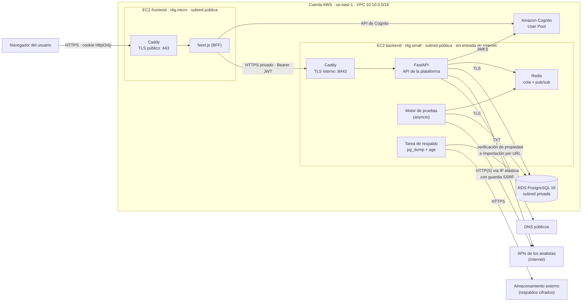
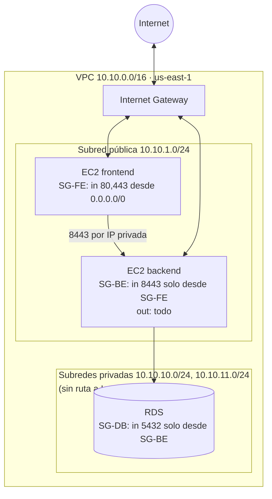
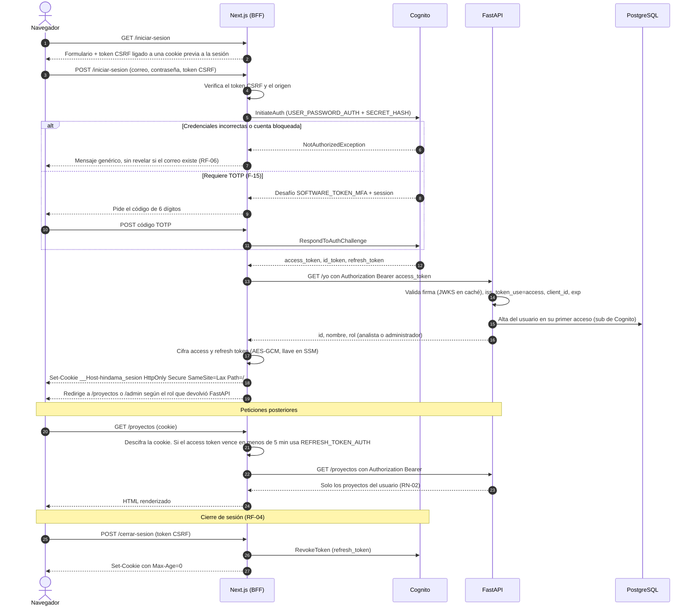
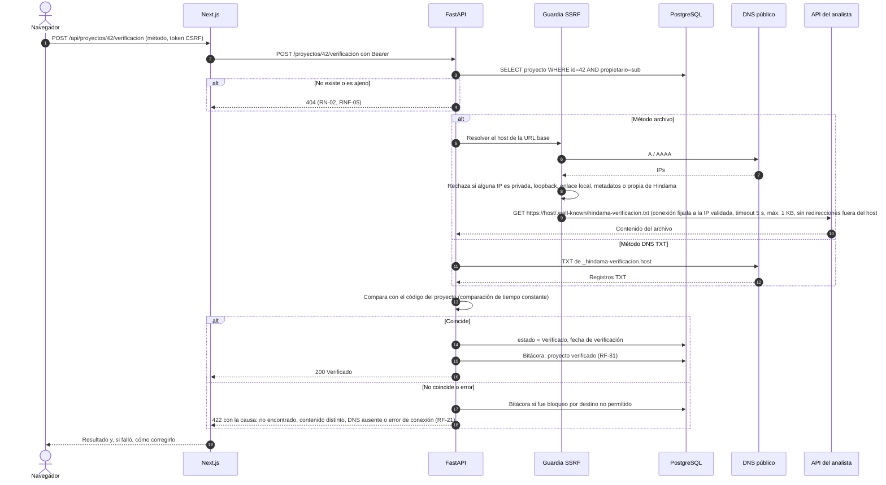
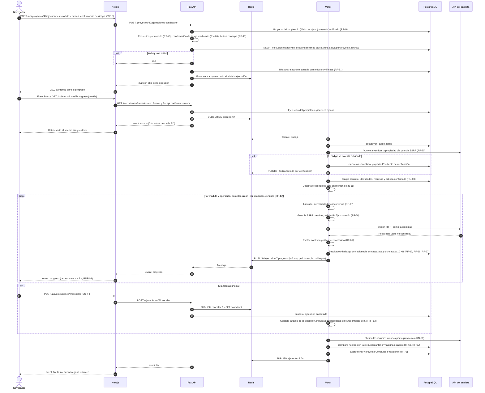
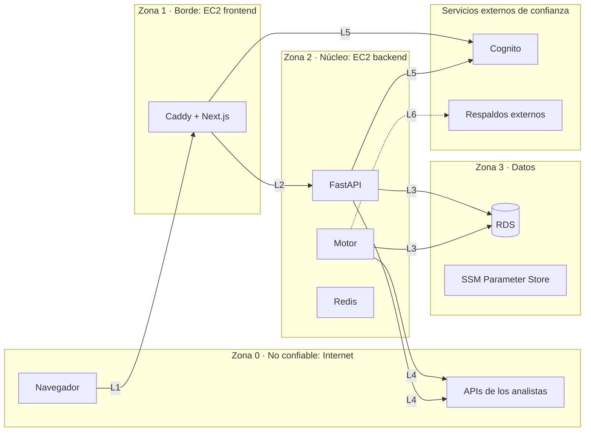

# Arquitectura — Hindama v1.0

Este documento describe los componentes de Hindama, cómo se despliegan en AWS, los flujos clave y dónde se aplica cada regla de seguridad. Los requerimientos que se citan (F, RF, RN, RNF) están en [`00-producto/requerimientos.md`](../00-producto/requerimientos.md). Las decisiones que lo justifican están en [`decisiones/`](decisiones/).

Las cifras de capacidad y de costo de este documento son **supuestos**: todavía no hay código ni datos reales. Cada supuesto indica cuándo se valida y qué se hace si falla (sección 7).

## Cambios respecto a la versión 0.1

| Cambio | Motivo | Decisión |
| --- | --- | --- |
| Una sola cuenta de AWS en lugar de dos con VPC peering | La entrega es a finales de noviembre de 2026: la plataforma vive en AWS unas semanas, no 6 meses. Una cuenta alcanza y la división solo agregaba complejidad. | [ADR-010](decisiones/ADR-010-una-sola-cuenta-aws.md) sustituye a ADR-001 |
| Docker Compose y un procedimiento de despliegue escrito en lugar de Terraform | Con 4 semanas de desarrollo, el código de infraestructura compite con el producto. | [ADR-011](decisiones/ADR-011-despliegue-con-compose-y-procedimiento.md) sustituye a ADR-009 |
| Motor asíncrono con varias ejecuciones por proceso en lugar de un proceso RQ por ejecución | Diez procesos RQ no caben en 2 GB, y la cancelación debe interrumpir peticiones en curso. | [ADR-012](decisiones/ADR-012-motor-asincrono.md) |
| Limpieza de ejecuciones en cola tras reiniciar Redis, y Redis con AOF | Una ejecución `en_cola` perdida bloqueaba el proyecto para siempre (RN-07). | Sección 4.3, [ADR-003](decisiones/ADR-003-rds-redis-en-compose-y-respaldos-fuera-de-aws.md) |
| Verificación DNS en `_hindama-verificacion.<host>` solo para el host exacto | El alcance de «dominio de la URL base» era ambiguo. | Sección 4.2 |
| `User-Agent` identificable y página de contacto por abuso | Un reporte de abuso a AWS podía suspender la cuenta. | Sección 5.4 |
| Usuarios de base de datos separados para la API y el motor, y límites de memoria por contenedor | Privilegios mínimos y evitar que el motor deje sin memoria a la API. | Secciones 3.1 y 5.2 |

## 1. Resumen

- **Una cuenta de AWS** (`us-east-1`), una VPC ([ADR-010](decisiones/ADR-010-una-sola-cuenta-aws.md)). La segunda cuenta del equipo queda como respaldo: si la principal falla, la plataforma se despliega ahí con el mismo procedimiento.
- **Cómputo:** dos EC2 con Docker Compose ([ADR-002](decisiones/ADR-002-ec2-con-docker-compose.md)):
  - **Frontend:** Caddy + Next.js (BFF).
  - **Backend:** Caddy + FastAPI + motor de pruebas + Redis + tarea de respaldo.
- **Datos:** PostgreSQL en Amazon RDS. Redis en el Compose del backend. Respaldos diarios cifrados fuera de AWS ([ADR-003](decisiones/ADR-003-rds-redis-en-compose-y-respaldos-fuera-de-aws.md)).
- **FastAPI no es pública:** la EC2 del backend no acepta tráfico de Internet; su security group solo admite al security group del frontend. Sale a Internet con una IP elástica fija ([ADR-004](decisiones/ADR-004-red-del-backend-sin-nat.md)).
- **Sesión BFF:** el navegador solo habla con Next.js; los tokens de Cognito viven en una cookie cifrada HttpOnly ([ADR-005](decisiones/ADR-005-sesion-bff-con-cookie-cifrada.md)).
- **Motor asíncrono:** un proceso atiende varias ejecuciones a la vez con `asyncio` ([ADR-012](decisiones/ADR-012-motor-asincrono.md)).
- **Progreso por SSE:** el motor publica en Redis, FastAPI emite el stream y Next.js lo retransmite ([ADR-006](decisiones/ADR-006-progreso-por-sse-con-redis-pubsub.md)).
- **Despliegue:** Docker Compose con imágenes publicadas por la CI y un procedimiento escrito ([ADR-011](decisiones/ADR-011-despliegue-con-compose-y-procedimiento.md)).

## 2. Componentes

### 2.1 Diagrama de componentes

### 2.2 Responsabilidades

| Componente | Responsabilidad | No hace |
| --- | --- | --- |
| **Caddy (frontend)** | Termina TLS público con Let's Encrypt para el subdominio de Hindama, redirige HTTP a HTTPS y reenvía a Next.js. Sobrescribe `X-Forwarded-For` con la IP real del cliente. | Nada de lógica. |
| **Next.js (BFF)** | Renderiza la interfaz, gestiona la sesión con Cognito (cookie cifrada, renovación de tokens), protege contra CSRF, envía las cabeceras de seguridad y reenvía cada petición a FastAPI con el token de acceso. Retransmite el SSE de progreso. Sirve la página pública «Acerca del tráfico de Hindama» (sección 5.4). | Decidir permisos, filtrar datos por usuario, validar reglas de negocio (RNF-08). |
| **Amazon Cognito** | Registro, verificación de correo, inicio de sesión, recuperación de contraseña, bloqueo por intentos fallidos, TOTP y emisión de JWT. Grupo `administradores` (RF-09). | Guardar datos de proyectos. |
| **Caddy (backend)** | Termina TLS entre las dos EC2 con un certificado de su CA interna (`tls internal`); Next.js confía en esa CA. Solo escucha en la IP privada. | Exponer nada a Internet. |
| **FastAPI** | Valida el JWT en cada petición (RF-07) y aplica toda la autorización por rol y por propietario (RN-02, RNF-05). Expone la API REST, el stream SSE, la verificación de propiedad, la importación de contratos, el cifrado de credenciales y la bitácora. Limita a 100 peticiones por minuto por usuario (RNF-09). Encola ejecuciones. | Ejecutar pruebas largas. |
| **Motor de pruebas** | Proceso asíncrono que atiende varias ejecuciones a la vez ([ADR-012](decisiones/ADR-012-motor-asincrono.md)): vuelve a verificar la propiedad, aplica límites y la guardia SSRF, envía las peticiones, evalúa respuestas, registra hallazgos con evidencia enmascarada, publica el progreso y atiende la cancelación. | Recibir tráfico entrante. |
| **Redis** | Cola de ejecuciones, canal pub/sub de progreso, banderas de cancelación y contadores de rate limit. Sin puerto publicado, con contraseña y con AOF. | Ser fuente de verdad: la limpieza de arranque reconcilia su estado con PostgreSQL (sección 4.3). |
| **RDS PostgreSQL 16** | Fuente de verdad: usuarios, proyectos, contratos, identidades (credenciales cifradas), recursos, políticas, ejecuciones, resultados, hallazgos y bitácora. Cifrado en reposo y respaldo automático de 7 días (RNF-17). | Aceptar conexiones que no vengan de la EC2 del backend. |
| **Tarea de respaldo** | Diario: `pg_dump`, cifrado con `age` (llave pública; la privada se guarda fuera de línea) y subida a un almacenamiento externo con retención de 7 copias. | — |
| **APIs de los analistas** | Destino de las pruebas. Se tratan como **no confiables**: sus respuestas son datos, nunca código. | — |

### 2.3 Contenedores por EC2

| EC2 | Contenedores (Docker Compose) | Límite de memoria (supuesto) | Puertos expuestos |
| --- | --- | --- | --- |
| Frontend | `caddy`, `next` | `next`: 512 MB | 80 y 443 hacia Internet |
| Backend | `caddy`, `api` (uvicorn, 2 workers), `motor` (1–2 procesos), `redis`, `respaldo` | `api`: 512 MB · `motor`: 768 MB · `redis`: 128 MB | 8443 solo en la IP privada, permitido únicamente al SG del frontend |

Los límites de memoria por contenedor evitan que el motor deje sin memoria a la API. Las imágenes se construyen para `linux/arm64` (Graviton) en GitHub Actions y se publican en GitHub Container Registry. Cada EC2 las descarga con un token de solo lectura guardado en SSM Parameter Store.

## 3. Despliegue en AWS

### 3.1 Servicios por componente

| Componente | Servicio de AWS | Configuración |
| --- | --- | --- |
| Next.js + Caddy | **EC2** t4g.micro (2 vCPU, 1 GB), Amazon Linux 2023, EBS gp3 20 GB cifrado | Subred pública, IP elástica (registro A del subdominio). SG-FE: entrada 80/443 desde `0.0.0.0/0`. Sin SSH. |
| FastAPI + motor + Redis + Caddy | **EC2** t4g.small (2 vCPU, 2 GB), EBS gp3 30 GB cifrado, swap de 2 GB | Subred pública, IP elástica (IP de salida del motor). SG-BE: entrada 8443 solo desde SG-FE. Ninguna otra entrada. |
| PostgreSQL | **Amazon RDS** PostgreSQL 16, db.t4g.micro, Single-AZ, 20 GB | Subredes privadas (sin ruta a Internet), `publicly_accessible = false`. SG-DB: 5432 solo desde SG-BE. Cifrado en reposo y `rds.force_ssl = 1`. Respaldos automáticos de 7 días. Usuarios separados por componente (sección 5.2). |
| Identidad | **Amazon Cognito** User Pool (plan Lite o Essentials) | Cliente de aplicación confidencial (con secreto) para Next.js. Política de contraseñas de 12 caracteres (RF-03), protección contra fuerza bruta (RF-06), grupo `administradores`. |
| Secretos | **SSM Parameter Store** (SecureString con la llave administrada `aws/ssm`) | Clave maestra AES-256 de credenciales, contraseñas de los usuarios de RDS, contraseña de Redis, llave de cifrado de la cookie, secreto del cliente de Cognito y token del registro de imágenes. Se cargan como variables de entorno al arrancar ([ADR-007](decisiones/ADR-007-cifrado-de-credenciales-aes-gcm.md)). Cada EC2 solo puede leer su ruta (`/hindama/frontend/*` o `/hindama/backend/*`). |
| Acceso de operación | **SSM Session Manager** | Administración de las EC2 sin puerto SSH abierto. |
| Registros | **CloudWatch Logs** | Driver `awslogs` de Docker, con retención de 14 días. Los registros nunca contienen credenciales ni tokens (RN-11). |
| Recuperación | **EC2 auto-recovery** + `restart: unless-stopped` | Ayudan a cumplir RNF-16 (99 %) y RNF-20 (reinicio en menos de 5 minutos). |
| Metadatos de instancia | **IMDSv2 obligatorio, `http_put_response_hop_limit = 1`** | Los contenedores no pueden llegar a `169.254.169.254` aunque la guardia SSRF fallara. |
| Presupuesto | **AWS Budgets** | Alertas al 50 %, 80 % y 100 % de los créditos. |

**Dominio y TLS.** El equipo tiene dos dominios propios. Hindama usa un **subdominio** de uno de ellos (por ejemplo, `hindama.<dominio>`), con un registro A hacia la IP elástica del frontend. El registro DNS se administra donde ya están los dominios; no hace falta Route 53. Caddy obtiene y renueva el certificado con Let's Encrypt. Es requisito del primer despliegue: sin HTTPS no funciona la cookie `__Host-` y, por lo tanto, no hay sesión. No se usa ALB, CloudFront ni NAT Gateway porque cada uno consumiría de 15 a 35 USD al mes de los créditos ([ADR-002](decisiones/ADR-002-ec2-con-docker-compose.md), [ADR-004](decisiones/ADR-004-red-del-backend-sin-nat.md)).

### 3.2 Diagrama de red

Las reglas usan referencias entre security groups, no rangos de IP: solo la instancia con SG-FE puede llegar al puerto 8443 del backend, aunque otras instancias compartan la subred. RDS exige un grupo de subredes con al menos dos zonas, por eso hay dos subredes privadas. La instancia de RDS es Single-AZ y queda en la misma zona que las EC2.

### 3.3 Costo (supuesto)

Precios de lista de `us-east-1` en octubre de 2026, redondeados. Se confirman en la [calculadora de AWS](https://calculator.aws/) antes de desplegar.

| Concepto | USD al mes |
| --- | --- |
| EC2 t4g.micro (frontend) | ≈ 6.13 |
| EC2 t4g.small (backend) | ≈ 12.26 |
| EBS gp3, 50 GB en total | ≈ 4.00 |
| Dos IPv4 públicas (IP elásticas) | ≈ 7.30 |
| RDS db.t4g.micro + 20 GB | ≈ 14.00 |
| Cognito (hasta 10 000 usuarios activos), SSM, CloudWatch Logs (dentro de lo gratuito) | 0 |
| **Total** | **≈ 44 USD al mes** |

- **Prueba gratuita de t4g.small:** sigue vigente hasta el 31 de diciembre de 2026, pero en las cuentas del *plan gratuito* solo están activas las ofertas «Always Free», así que lo más probable es que **no aplique**. El cálculo no la cuenta. Se confirma en *Billing → Free Tier*.
- **Periodo en AWS:** del despliegue (mediados de noviembre) a la entrega y la evaluación, unas 4–8 semanas: **≈ 45–90 USD**. Cabe en los 100 USD iniciales de la cuenta, y hay hasta 100 USD más por las actividades de AWS (lanzar EC2, crear RDS y configurar un presupuesto forman parte de este mismo despliegue).
- Fuera de los días de prueba y demo, RDS y las EC2 se pueden detener para ahorrar créditos. Las IP elásticas siguen cobrando mientras estén asignadas.

### 3.4 Capacidad (supuesto)

| Supuesto | Se valida | Si falla |
| --- | --- | --- |
| El backend (API, motor, Redis, Caddy) cabe en 2 GB con 10 ejecuciones simultáneas (RNF-04) | Prueba de carga de la semana 3: 10 ejecuciones contra el laboratorio, midiendo memoria con `docker stats` | Bajar la concurrencia del motor y dejar las ejecuciones extra en cola, o pasar a t4g.medium (≈ 24 USD al mes). |
| El frontend cabe en 1 GB | Primer despliegue | Pasar a t4g.small. |
| La base de datos no pasa de 20 GB | No aplica a la escala de la entrega | Ampliar el almacenamiento de RDS. |

## 4. Flujos clave

### 4.1 Inicio de sesión con cookie HttpOnly

El formulario de inicio de sesión es propio de Hindama, no la interfaz alojada de Cognito. Next.js habla con Cognito desde el servidor con un cliente confidencial, así que los tokens nunca llegan al navegador (RF-08).

Detalles:

- **Cookie:**
  - Se guardan solo el access token y el refresh token. Los datos del usuario se piden a `/yo`.
  - Si el valor cifrado supera 4 KB, se divide en fragmentos (`__Host-hindama_sesion.0`, `.1`).
  - El prefijo `__Host-` impide que un subdominio la sobrescriba.
- **Rol:** Next.js solo usa el rol para elegir a qué pantalla redirigir. Cada petición vuelve a autorizarse en FastAPI (RNF-08).
- **CSRF:**
  - Las peticiones que modifican datos llevan un token sincronizado guardado dentro de la sesión cifrada y enviado en la cabecera `X-CSRF-Token`.
  - Next.js además rechaza las peticiones cuyo `Origin` no sea el subdominio de Hindama.
- **Usuarios en la base de datos:** FastAPI da de alta al usuario en su primer acceso, con `INSERT … ON CONFLICT (sub) DO NOTHING` para que dos peticiones simultáneas no creen duplicados. Así no hace falta un disparador Lambda de Cognito con acceso a RDS.
- **La contraseña pasa por el servidor de Next.js** (dentro de TLS). Next.js nunca registra cuerpos de petición de las rutas de autenticación.

### 4.2 Verificación de propiedad

La verificación es válida **solo para el host exacto** de la URL base (por ejemplo, `api.ejemplo.com`), nunca para su dominio padre ni para otros subdominios.

- El registro TXT usa el prefijo `_hindama-verificacion.` (práctica estándar para registros de verificación): no ensucia el dominio y solo lo puede crear quien controla la zona de ese host.
- **Limitación declarada:** si varias APIs comparten un host y se distinguen por ruta (por ejemplo, `plataforma.com/usuario1/api`), quien publique el archivo en ese host verifica el host completo. Hindama solo prueba la URL base del proyecto y las rutas de su contrato.
- La verificación se repite al iniciar cada ejecución dentro del motor (RF-20, flujo 4.3).

### 4.3 Ejecución de pruebas de principio a fin con progreso por SSE

Detalles:

- **Cancelación:** cada ejecución corre como una tarea de `asyncio`. Al recibir la señal, el motor cancela la tarea completa, lo que interrumpe también la petición HTTP en curso, sin esperar su tiempo de espera de 15 s. Después corre la limpieza de recursos creados (RN-06).
- **Reconexión del SSE:**
  - Cada evento lleva `id:`. Si la conexión se cae, el navegador reconecta con `Last-Event-ID`.
  - FastAPI responde con la foto actual de la base de datos antes de volver a suscribirse, así que no se pierde el estado aunque se pierdan eventos intermedios.
  - Se envía un comentario `: ping` cada 15 segundos para mantener viva la conexión.
- **Limpieza de arranque (RNF-18).** Cada vez que arranca el motor, y cada 5 minutos, reconcilia PostgreSQL con Redis:
  - Ejecuciones `en_curso` con el latido vencido: pasan a «Fallida», se eliminan los recursos anotados en la bitácora de recursos creados y se conservan los resultados parciales.
  - Ejecuciones `en_cola` cuyo trabajo ya no existe en Redis (por ejemplo, tras perder la cola): se vuelven a encolar si tienen menos de 10 minutos; si no, pasan a «Fallida». Así ningún proyecto queda bloqueado por el índice de una ejecución activa (RN-07).
  - Antes de crear un recurso en la API del analista, el motor lo anota en la base de datos, para poder borrarlo aunque el proceso muera.
- **Duración máxima:** el motor controla el límite de 30 minutos (RF-47) y cancela la tarea al cumplirse. El trabajo en la cola tiene un tiempo máximo de 31 minutos como red de seguridad.

## 5. Seguridad

### 5.1 Límites de confianza

| Límite | Qué cruza | Supuesto de confianza | Controles |
| --- | --- | --- | --- |
| **L1** Navegador → Next.js | Peticiones del usuario, cookie de sesión | Nada de lo que envía el navegador es confiable. | TLS 1.2+ y HSTS. Cookie `__Host-` HttpOnly, Secure, SameSite=Lax y cifrada. Token anti-CSRF y verificación de `Origin`. CSP con nonce y `X-Content-Type-Options: nosniff` (RNF-07). Los tokens nunca llegan al navegador (RF-08). |
| **L2** Next.js → FastAPI | Peticiones con Bearer JWT, IP del cliente | FastAPI no confía en Next.js para autorizar: Next.js solo transporta el token. | Solo SG-FE llega al puerto 8443. TLS interno. Validación del JWT en cada petición (RF-07). Autorización por rol y por propietario en FastAPI (RNF-05, RNF-08). La cabecera con la IP del cliente se acepta solo desde la IP privada del frontend y se usa solo para la bitácora (RF-82). Rate limit por usuario (RNF-09). Errores sin detalles internos (RNF-07). |
| **L3** Backend → datos | Consultas SQL, secretos | Solo la EC2 del backend habla con RDS. | RDS en subred privada con SG restringido y `force_ssl`. Usuarios de base de datos separados por componente con privilegios mínimos (sección 5.2). Credenciales de identidades cifradas con AES-256-GCM antes de guardarse (RNF-06). |
| **L4** Plataforma → APIs de los analistas | Peticiones de prueba con credenciales de identidades, respuestas | El destino puede ser hostil: puede intentar redirigir a la red interna, responder enormemente o inyectar contenido. | Verificación de propiedad previa y antes de cada ejecución (RN-01, RF-19, RF-20). Guardia SSRF con IP fijada y sin redirecciones fuera del host ([ADR-008](decisiones/ADR-008-guardia-ssrf-con-ip-fijada.md)). IMDSv2 con límite de saltos de 1. Límites de velocidad, tamaño y duración (RF-47). Evidencia truncada y enmascarada (RF-66, RF-67). La interfaz muestra la evidencia como texto escapado, nunca como HTML. `User-Agent` identificable (sección 5.4). |
| **L5** Plataforma → Cognito | Autenticación, JWKS | Cognito es confiable como emisor de identidad. | El secreto del cliente vive solo en el servidor de Next.js. FastAPI valida `iss`, `client_id`, `token_use` y `exp`. El rol de administrador sale del grupo de Cognito y solo lo asigna el equipo (RN-04, RF-09). |
| **L6** Respaldos → almacenamiento externo | Volcados de la base de datos | El proveedor externo no es confiable para leer los datos. | Cifrado con `age` antes de salir (llave privada fuera de línea). Credencial de subida con el permiso mínimo. Retención de 7 copias, compatible con el borrado en 30 días (sección 11 de requerimientos). |
| Operadores → AWS | Consola, Session Manager | Solo los dos integrantes. | Un usuario IAM por integrante con MFA; MFA en el usuario raíz. Sin llaves SSH. Session Manager auditado en CloudTrail. |

### 5.2 Usuarios de base de datos

| Usuario | Lo usa | Privilegios |
| --- | --- | --- |
| `hindama_migraciones` | Alembic, solo durante el despliegue | Dueño del esquema: crea y modifica tablas. |
| `hindama_api` | FastAPI | Lectura y escritura sobre las tablas de la aplicación. Sobre la bitácora, solo `INSERT` y `SELECT` (RF-83). |
| `hindama_motor` | Motor de pruebas | Lectura de proyectos, contratos, identidades, recursos y políticas. Escritura solo en ejecuciones, resultados, hallazgos, recursos creados y bitácora (solo `INSERT`). |
| `hindama_respaldo` | Tarea de respaldo | Solo lectura (`pg_dump`). |

Ningún usuario de la aplicación puede ejecutar `DROP`, ni `UPDATE` o `DELETE` sobre la bitácora.

### 5.3 Dónde se aplica cada regla

| Regla | Componente que la aplica | Mecanismo |
| --- | --- | --- |
| **RN-01** Sin peticiones a APIs no verificadas | FastAPI (al crear la ejecución) y motor (al iniciarla) | Estado `Verificado` obligatorio y nueva comprobación del código antes de cada ejecución. La guardia SSRF solo permite el host verificado. |
| **RN-02 / RNF-05** Aislamiento por propietario | FastAPI (capa de repositorio) | Toda consulta de un proyecto o de sus hijos filtra por `propietario_id = sub`. Lo ajeno responde 404. Hay pruebas automatizadas de acceso cruzado por endpoint. |
| **RN-03 / RF-80** El administrador no ve proyectos | FastAPI | Las dependencias de rol niegan con 403 los endpoints de proyectos al rol administrador. Los endpoints de administración solo consultan vistas agregadas sin URLs ni evidencias (RF-79). |
| **RN-04 / RF-09** Rol de administrador desde Cognito | Cognito + FastAPI | Grupo `administradores` en el claim `cognito:groups`. No existe ningún endpoint que asigne roles. |
| **RN-05 / RF-46** Módulos de riesgo apagados por defecto | FastAPI | La petición de ejecución exige `confirmacion_riesgo = true` por cada módulo de riesgo medio o alto; si falta, responde 422. La interfaz solo lo presenta. |
| **RN-06 / RF-48** Solo se modifica lo creado por la plataforma | Motor | Las escrituras se limitan a recursos anotados en la bitácora de recursos creados, con limpieza al terminar, cancelar o fallar. |
| **RN-07 / RF-53** Una ejecución activa por proyecto | PostgreSQL + FastAPI + motor | Índice único parcial sobre `proyecto_id` para estados activos; responde 409. La limpieza de arranque evita bloqueos permanentes (sección 4.3). |
| **RN-08 / RF-40** Política propuesta no se usa sin confirmar | Motor | Solo se cargan reglas con `confirmada = true`. |
| **RN-09** Justificación al aceptar riesgo | FastAPI | La justificación es obligatoria en el esquema Pydantic y la acción queda en la bitácora. |
| **RN-10 / RF-73** Proyecto concluido | Motor (al cerrar la ejecución) | Recalcula el estado según los hallazgos abiertos. |
| **RN-11 / RNF-06** Credenciales protegidas | FastAPI y motor | AES-256-GCM con la clave en SSM ([ADR-007](decisiones/ADR-007-cifrado-de-credenciales-aes-gcm.md)). Las respuestas solo devuelven los últimos 4 caracteres. Filtros de enmascarado en los registros y en la evidencia. Los modelos Pydantic de salida no incluyen el campo cifrado. |
| **RN-12 / RF-16** Términos aceptados | FastAPI | Crear un proyecto responde 403 si el usuario no tiene `terminos_aceptados_en`. |
| **RNF-07** Cabeceras, CSRF, API no pública, errores sin detalles | Next.js (cabeceras y CSRF), red (API no pública), FastAPI (manejador global de excepciones) | Ver L1 y L2. |
| **RNF-08** Autorización solo en el backend | FastAPI | Next.js no contiene comprobaciones de permisos; cualquier decisión de visibilidad en la interfaz es solo cosmética. |
| **RNF-09** 100 peticiones por minuto por usuario | FastAPI + Redis | Ventana deslizante por `sub`. |
| **RNF-10** Sin hallazgos críticos ni altos | CI | Bandit, pip-audit, npm audit, Trivy (imágenes) y OWASP ZAP contra el despliegue. Hindama también se prueba a sí misma. |
| **RNF-16, RNF-20** Disponibilidad y reinicio | EC2 + Compose | Auto-recovery, políticas de reinicio y arranque idempotente. |
| **RNF-17** Respaldos | RDS + tarea de respaldo | 7 días automáticos en RDS más 7 copias diarias cifradas fuera de AWS. |
| **RNF-18** Ejecución interrumpida | Motor | Latido, limpieza de arranque y bitácora de recursos creados (sección 4.3). |

### 5.4 Tráfico saliente y reportes de abuso

Todo el tráfico de prueba sale de una sola IP elástica de AWS hacia APIs de terceros. Si el dueño de una API lo reporta como abuso, AWS puede restringir o suspender la cuenta, y con ella toda la plataforma. La verificación de propiedad es la defensa principal; además:

- Toda petición saliente lleva el `User-Agent` `Hindama-Scanner/1.0 (+https://<subdominio>/acerca-del-trafico)`, para que quien vea el tráfico sepa de dónde viene.
- La página pública **«Acerca del tráfico de Hindama»** explica qué es la plataforma, que solo prueba APIs con propiedad verificada, cuál es su IP de salida y cómo reportar un uso indebido (un correo de contacto del equipo).
- Un reporte recibido se investiga con la bitácora (RF-81, RF-82): qué proyecto, qué analista y cuándo.
- Si la cuenta principal se suspende, la plataforma se despliega en la cuenta de respaldo ([ADR-011](decisiones/ADR-011-despliegue-con-compose-y-procedimiento.md)).

## 6. Respaldo y recuperación

| Escenario | Respuesta |
| --- | --- |
| Se cae una EC2 | Auto-recovery y `restart: unless-stopped`; la limpieza de arranque reconcilia las ejecuciones. |
| Se corrompe o borra la base de datos | Restaurar desde los respaldos automáticos de RDS (7 días). |
| Se pierde la cuenta de AWS (suspensión, créditos agotados) | Desplegar en la cuenta de respaldo con el procedimiento de [ADR-011](decisiones/ADR-011-despliegue-con-compose-y-procedimiento.md) y restaurar el último volcado externo. Cognito se recrea vacío: los usuarios se registran de nuevo. La IP de salida cambia y se actualiza en la página «Acerca del tráfico». |
| Se pierde la llave privada de `age` | Las copias externas quedan inservibles. La llave se guarda fuera de línea en dos lugares, junto con una copia de la clave maestra de credenciales. |

Antes de la entrega se hace **una restauración de prueba completa** desde el volcado externo en un entorno local, para comprobar que los respaldos sirven.

## 7. Supuestos y validación

| Supuesto | Se valida | Si falla |
| --- | --- | --- |
| Capacidad del backend en 2 GB (sección 3.4) | Semana 3, prueba de carga con 10 ejecuciones | Bajar la concurrencia o pasar a t4g.medium. |
| Costo ≈ 44 USD al mes (sección 3.3) | AWS Budgets, a la semana del despliegue | Detener RDS y las EC2 fuera de los días de prueba; pasar PostgreSQL a contenedor. |
| La biblioteca de la cola asíncrona (`arq` o `SAQ`) soporta cancelación y reintentos como se describe | Prueba técnica de la semana 1 ([ADR-012](decisiones/ADR-012-motor-asincrono.md)) | Elegir la otra o implementar un consumidor simple sobre Redis. |
| El transporte de httpx con IP fijada valida TLS contra el nombre original | Prueba técnica de la semana 1 ([ADR-008](decisiones/ADR-008-guardia-ssrf-con-ip-fijada.md)) | Usar un proxy de salida (Smokescreen) para fijar la IP. |
| Cognito permite el flujo de formulario propio con cliente confidencial | Semana 1, al configurar el User Pool | Usar la interfaz alojada de Cognito con PKCE ([ADR-005](decisiones/ADR-005-sesion-bff-con-cookie-cifrada.md)). |

## 8. Entorno local

`docker compose` levanta en el equipo de desarrollo:

- Los mismos contenedores de ambas EC2.
- PostgreSQL 16 en contenedor, en lugar de RDS.
- Un User Pool de desarrollo en Cognito (o un emulador local).
- El laboratorio de validación (VAmPI y la mini API en modo seguro y vulnerable).

El laboratorio nunca se despliega en AWS (sección 6 de requerimientos). En local, la guardia SSRF tiene una lista de permitidos explícita solo para los nombres de servicio del laboratorio. Esa lista no existe en la configuración de producción.

## 9. Decisiones abiertas

| Tema | Estado |
| --- | --- |
| Subdominio | Se usa un subdominio de uno de los dos dominios del equipo. Falta elegir cuál y dar de alta el registro A al desplegar. |
| Almacenamiento externo de respaldos | Propuesta: una cuenta de Google Drive dedicada al proyecto, vía `rclone` con permiso `drive.file` (solo los archivos que crea) y con versiones activadas. Se descarga una copia manual a la computadora de un integrante cada semana. |
| Biblioteca de la cola asíncrona | `arq` o `SAQ`, se elige en la prueba técnica de la semana 1 ([ADR-012](decisiones/ADR-012-motor-asincrono.md)). |
| Exigir 2FA a administradores (RF-86) | Cognito no permite exigir MFA por grupo. Propuesta: un segundo User Pool solo para administradores con MFA obligatorio; FastAPI acepta los dos emisores. Se decide al llegar a F-15. |
| Ubicación de los archivos de despliegue | Propuesta: carpeta `deploy/` en `hindama-backend` (Compose de producción de ambas EC2 y el procedimiento). |
| Modelo de amenazas STRIDE | Siguiente documento: [`amenazas.md`](amenazas.md), basado en la sección 5. |

## 10. Índice de decisiones

| ADR | Decisión | Estado |
| --- | --- | --- |
| [ADR-001](decisiones/ADR-001-despliegue-en-dos-cuentas-aws.md) | Despliegue repartido en dos cuentas de AWS con VPC peering | Sustituida por ADR-010 |
| [ADR-002](decisiones/ADR-002-ec2-con-docker-compose.md) | Dos EC2 con Docker Compose y Caddy, sin ALB | Aceptada |
| [ADR-003](decisiones/ADR-003-rds-redis-en-compose-y-respaldos-fuera-de-aws.md) | PostgreSQL en RDS, Redis en Compose y respaldos cifrados fuera de AWS | Aceptada |
| [ADR-004](decisiones/ADR-004-red-del-backend-sin-nat.md) | Backend en subred pública con SG cerrado e IP elástica, sin NAT | Aceptada |
| [ADR-005](decisiones/ADR-005-sesion-bff-con-cookie-cifrada.md) | Sesión BFF: tokens de Cognito en cookie cifrada HttpOnly | Aceptada |
| [ADR-006](decisiones/ADR-006-progreso-por-sse-con-redis-pubsub.md) | Progreso por SSE con Redis pub/sub retransmitido por Next.js | Aceptada |
| [ADR-007](decisiones/ADR-007-cifrado-de-credenciales-aes-gcm.md) | Credenciales cifradas con AES-256-GCM y clave en SSM Parameter Store | Aceptada |
| [ADR-008](decisiones/ADR-008-guardia-ssrf-con-ip-fijada.md) | Guardia SSRF única con resolución previa e IP fijada | Aceptada |
| [ADR-009](decisiones/ADR-009-infraestructura-como-codigo-terraform.md) | Infraestructura como código con Terraform en una o dos cuentas | Sustituida por ADR-011 |
| [ADR-010](decisiones/ADR-010-una-sola-cuenta-aws.md) | Una sola cuenta de AWS; la segunda queda como respaldo | Aceptada |
| [ADR-011](decisiones/ADR-011-despliegue-con-compose-y-procedimiento.md) | Despliegue con Docker Compose y procedimiento escrito; Terraform diferido | Aceptada |
| [ADR-012](decisiones/ADR-012-motor-asincrono.md) | Motor de pruebas asíncrono con varias ejecuciones por proceso | Aceptada |
