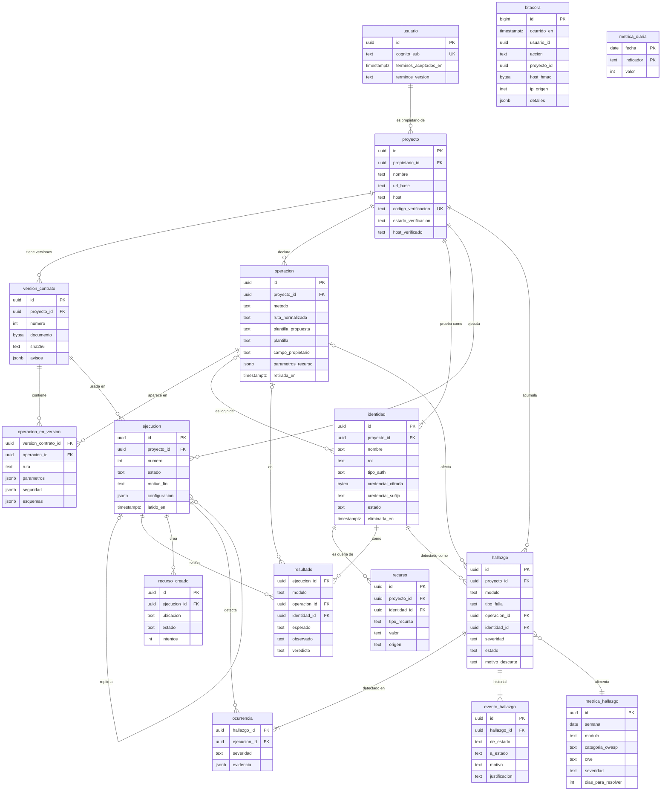
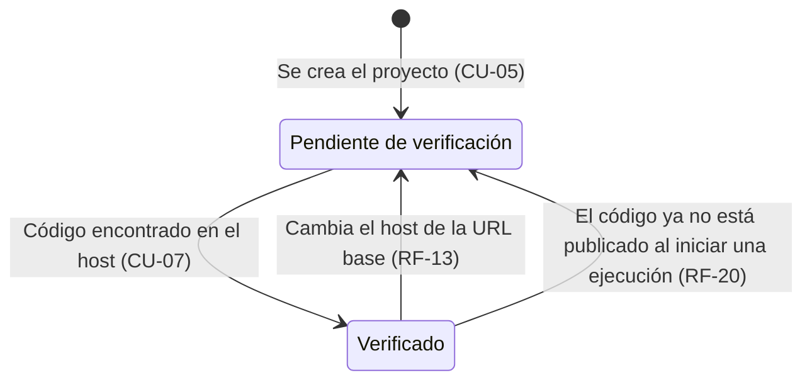
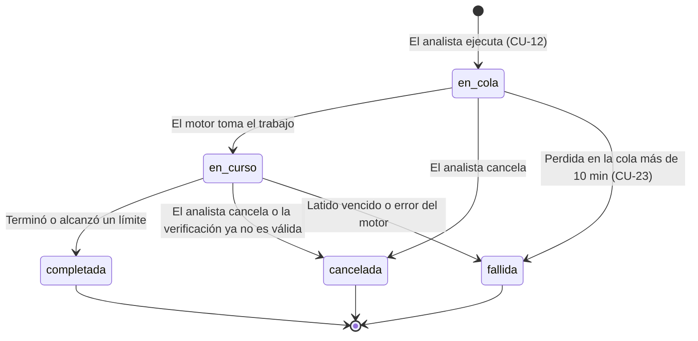
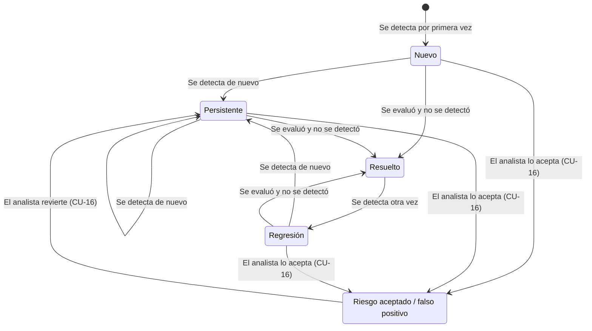

# Modelo de datos — Hindama v1.0

Este documento define las entidades que Hindama guarda en PostgreSQL 16, cómo se relacionan, los estados de las que los tienen y las reglas que **la base de datos** garantiza por sí misma. Es la base del esquema (migraciones de Alembic) y del contrato de la API ([`03-api/openapi.yaml`](../03-api/openapi.yaml)).

Es un modelo **lógico**: nombra las columnas que importan para entender las reglas, no todas. Tipos exactos, longitudes, índices secundarios y valores por defecto se fijan en las migraciones (RNF-23). Si una migración contradice este documento, se corrige uno de los dos en el mismo pull request.

Los requerimientos citados (F, RF, RN, RNF) están en [`00-producto/requerimientos.md`](../00-producto/requerimientos.md); los casos de uso (CU), en [`00-producto/casos-de-uso.md`](../00-producto/casos-de-uso.md).

## 1. Decisiones de base

| Decisión | Resumen | Registro |
| --- | --- | --- |
| Identificadores | UUID v7 generados en la aplicación como llave primaria y en las URLs. Las ejecuciones llevan además un `numero` consecutivo por proyecto para mostrarlo («Ejecución 3»). | [ADR-013](../01-arquitectura/decisiones/ADR-013-aislamiento-por-propietario-en-el-esquema.md) |
| Aislamiento por propietario | Llaves foráneas compuestas con `proyecto_id` en cada tabla hija + Row-Level Security de PostgreSQL con el usuario de la petición fijado por transacción. | [ADR-013](../01-arquitectura/decisiones/ADR-013-aislamiento-por-propietario-en-el-esquema.md) |
| Seguimiento de hallazgos | Hallazgo lógico (único por huella) + ocurrencia por ejecución + evento por cambio de estado. Un hallazgo solo se resuelve si la ejecución volvió a evaluar exactamente su comprobación. | [ADR-014](../01-arquitectura/decisiones/ADR-014-seguimiento-de-hallazgos-por-huella-y-cobertura.md) |
| Borrado y retención | Borrado físico del proyecto y de la cuenta; borrado lógico de identidades; bitácora inmutable sin llaves foráneas y con el host en HMAC; métricas anónimas que sobreviven a cualquier borrado. | [ADR-015](../01-arquitectura/decisiones/ADR-015-borrado-retencion-y-anonimizacion.md) |
| Catálogos | Estados, módulos, severidades y demás listas cerradas como `text` + `CHECK`, no como `ENUM` de PostgreSQL: agregar un valor es una migración trivial. | — |
| Fechas | `timestamptz`, siempre en UTC. | — |
| Datos personales mínimos | La base de datos no guarda nombre ni correo del usuario: viven en Cognito. Solo guarda el `sub` de Cognito. | ADR-015 |

## 2. Diagrama entidad-relación

Las relaciones con `proyecto` se dibujan solo hacia las entidades principales; **todas** las tablas del bloque del proyecto llevan `proyecto_id` (sección 5.1). `bitacora`, `metrica_hallazgo` y `metrica_diaria` no tienen llaves foráneas a propósito (sección 7).

## 3. Entidades

### 3.1 Cuentas

**`usuario`** — Analista o administrador que entró al menos una vez. FastAPI lo da de alta en su primer acceso (`INSERT … ON CONFLICT (cognito_sub) DO NOTHING`, arquitectura 4.1).

| Campo | Notas |
| --- | --- |
| `id` | Identificador interno. Todo lo demás apunta a él, no al `sub`: si Cognito se recrea en la cuenta de respaldo, los datos se vuelven a ligar actualizando una columna. |
| `cognito_sub` | Único. |
| `terminos_aceptados_en`, `terminos_version` | RF-16, RN-12. Nulos hasta que acepta. |

No se guarda el **rol**: sale del claim `cognito:groups` en cada petición (RN-04). Una copia en la base de datos sería una segunda fuente de verdad que puede quedar vieja. Tampoco se guardan nombre ni correo (datos mínimos, sección 7.2): `/yo` obtiene el nombre de Cognito.

### 3.2 Proyecto y configuración

**`proyecto`** — Una API del analista (F-02).

| Campo | Notas |
| --- | --- |
| `propietario_id` | → `usuario`. Base del aislamiento (sección 5.1). |
| `nombre`, `descripcion` | RF-10: 100 y 500 caracteres; `CHECK` de longitud. |
| `url_base`, `host` | `host` lo extrae la aplicación de `url_base` (minúsculas, IDNA) y lo guarda aparte para que la base de datos pueda compararlo. |
| `codigo_verificacion` | RF-17. Aleatorio y único. No es secreto: el analista lo publica. |
| `estado_verificacion` | `pendiente` / `verificado` (sección 4.1). |
| `metodo_verificacion`, `verificado_en`, `host_verificado` | Se llenan al verificar. `host_verificado` es el host exacto que la guardia SSRF permite (ADR-008). |

El estado **concluido** y el número de hallazgos abiertos **no se guardan**: se calculan (sección 4.4).

**`version_contrato`** — Cada importación del contrato OpenAPI (RF-26). Es inmutable.

| Campo | Notas |
| --- | --- |
| `numero` | Consecutivo por proyecto; único `(proyecto_id, numero)`. |
| `documento` | El archivo original tal como llegó (máx. 5 MB, RF-22), para reproducir una ejecución. |
| `origen`, `url_origen`, `formato`, `version_openapi`, `sha256` | De dónde vino y qué es. |
| `avisos` | Lo que no se pudo interpretar y las referencias externas no seguidas (RF-23, RF-25, RF-27). |

**`operacion`** — Una operación de la API **a nivel proyecto**, identificada de forma estable por `(metodo, ruta_normalizada)`. Sobrevive a nuevas versiones del contrato, y por eso aquí viven la política y los parámetros de recurso.

| Campo | Notas |
| --- | --- |
| `metodo`, `ruta_normalizada` | Único `(proyecto_id, metodo, ruta_normalizada)`. La ruta se normaliza sustituyendo el nombre de cada parámetro por `{}`: `/users/{id}` y `/users/{userId}` son la misma operación. |
| `plantilla_propuesta` | Lo que sugiere el sistema (RF-40). |
| `plantilla`, `confirmada_en`, `modificada_en`, `modificada_por` | La política confirmada (RF-39, RF-43). Nula hasta que el analista confirma: el motor solo usa operaciones con `plantilla` no nula (RN-08). |
| `campo_propietario` | Obligatorio si la plantilla es `solo_propietario` o `propietario_o_admin` (RF-41): `CHECK`. |
| `parametros_recurso` | Qué parámetros de ruta identifican un recurso y de qué tipo (RF-35), con la corrección del analista. |
| `retirada_en` | Se llena cuando una importación ya no la incluye; se limpia si reaparece. Una operación retirada con política es una «regla huérfana» que la interfaz señala. |

Las cinco plantillas (RF-39): `publica`, `autenticado`, `solo_propietario`, `propietario_o_admin`, `solo_admin`.

**`operacion_en_version`** — El detalle de una operación tal como aparece en una versión concreta: ruta original, parámetros, esquemas de petición y respuesta, y seguridad declarada (RF-24). Llave `(version_contrato_id, operacion_id)`. Las diferencias entre versiones (RF-26) se calculan comparando estas filas.

**`identidad`** — Cuenta de prueba en la API del analista (F-05).

| Campo | Notas |
| --- | --- |
| `nombre` | «Usuario A». |
| `rol`, `rol_etiqueta` | `rol`: `administrador` / `usuario` / `otro` (lo usan los módulos de autorización, RF-57); `rol_etiqueta`: texto libre (RF-28). |
| `tipo_auth` | `ninguna` / `login` / `bearer` / `cookie` / `cabecera` (RF-29). |
| `credencial_cifrada`, `clave_version` | AES-256-GCM con el `id` de la identidad como dato asociado (ADR-007). En `login` contiene usuario y contraseña juntos. |
| `credencial_sufijo` | Los últimos 4 caracteres, lo único que se muestra (RF-31). |
| `nombre_campo` | Nombre de la cookie o de la cabecera. No es secreto. |
| `login_operacion_id` | → `operacion`. Endpoint de login para `login` automático (RF-30). |
| `estado`, `ultima_prueba_en`, `ultima_prueba_codigo` | `estado`: `activa` / `credencial_vencida` (RF-33). La prueba guarda solo el código de estado (RF-32). |
| `eliminada_en` | Borrado lógico (sección 7.1). |

**La identidad anónima** (RF-34) es una fila real con `tipo_auth = ninguna`, creada junto con el proyecto. Tener una fila real hace uniformes la huella, la matriz y las llaves foráneas. Reglas: a lo sumo una por proyecto (índice único parcial), sin credencial (`CHECK`), y no se puede eliminar (`CHECK eliminada_en IS NULL` cuando `tipo_auth = ninguna`).

**`recurso`** — Un objeto de la API del analista que pertenece a una identidad (F-06).

| Campo | Notas |
| --- | --- |
| `identidad_id` | Dueña del recurso. |
| `tipo_recurso`, `valor` | «pedido», «101». Único `(proyecto_id, tipo_recurso, valor)`: un objeto tiene un solo dueño. |
| `origen`, `confirmado` | `descubierto` / `manual` (RF-36, RF-37). |

### 3.3 Ejecución y resultados

**`ejecucion`** — Una corrida de uno o varios módulos (F-08).

| Campo | Notas |
| --- | --- |
| `numero` | Consecutivo por proyecto; único `(proyecto_id, numero)`. |
| `version_contrato_id` | La versión con la que se generaron las pruebas (RNF-19). |
| `origen_id` | → `ejecucion`. Lleno cuando es un «volver a probar» (RF-71). |
| `estado`, `motivo_fin` | Sección 4.2. |
| `configuracion` | Módulos, límites y confirmaciones de riesgo, tal como se validaron (RF-44, RF-46, RF-47). Repetir una ejecución es copiar este campo. |
| `creada_en`, `iniciada_en`, `terminada_en`, `latido_en`, `trabajo_id` | `latido_en` y `trabajo_id` los usa la reconciliación (CU-23). |
| `peticiones_enviadas`, `modulo_actual` | Foto del progreso para el SSE al reconectar (ADR-006). |

**`resultado`** — Una celda evaluada: `(ejecucion, modulo, operacion, identidad)`. Es a la vez la matriz identidad × operación (RF-64) y el registro de **qué se evaluó** que necesita la asignación de estados (sección 6).

| Campo | Notas |
| --- | --- |
| `operacion_id` | Nulo en las comprobaciones de toda la API (por ejemplo, CORS en Configuración). |
| `esperado`, `observado` | Lo que la política espera y lo que respondió la API (código y resumen). |
| `veredicto` | `ok` / `falla` / `omitido` / `error`. Solo `ok` y `falla` cuentan como evaluada. `omitido` cubre la credencial vencida (RF-33) y los requisitos faltantes. |

Único `(ejecucion_id, modulo, operacion_id, identidad_id) NULLS NOT DISTINCT`. El motor escribe la celda **al terminar** de evaluarla: si existe, se evaluó completa. Una celda a medias por cancelación o caída no deja fila.

Las peticiones individuales **no** se guardan; solo las que respaldan un hallazgo, como evidencia de su ocurrencia.

**`recurso_creado`** — Lo que la plataforma creó en la API del analista y debe borrar (RN-06, RF-48). El motor anota la fila **antes** de crear el recurso (arquitectura 4.3).

| Campo | Notas |
| --- | --- |
| `operacion_id`, `ubicacion` | Con qué operación se creó y la ruta para borrarlo. Sin credenciales. |
| `estado`, `intentos`, `ultimo_error` | `pendiente` / `eliminado` / `fallido`. Tras 3 intentos queda `fallido` y se informa al analista (CU-23 E1). |

### 3.4 Seguimiento de hallazgos

**`hallazgo`** — Una falla **lógica** del proyecto, que vive a lo largo de las ejecuciones (F-11).

| Campo | Notas |
| --- | --- |
| `modulo`, `tipo_falla`, `operacion_id`, `identidad_id` | La **huella** (RF-68). Único `(proyecto_id, modulo, tipo_falla, operacion_id, identidad_id) NULLS NOT DISTINCT`. `tipo_falla` es un código del catálogo del módulo que incluye su calificador cuando hace falta distinguir (por ejemplo, `config.cabecera_ausente.hsts` o `sqli.parametro.q`). |
| `severidad`, `categoria_owasp`, `cwe`, `titulo`, `recomendacion` | De la ocurrencia más reciente (RF-62). |
| `estado` | Sección 4.3. |
| `motivo_descarte`, `justificacion` | Solo en `riesgo_aceptado`: `riesgo_aceptado` / `falso_positivo` y su justificación obligatoria (RF-70, RN-09). `CHECK` de ambos. |
| `motivo_resolucion` | En `resuelto`: `no_detectado` / `identidad_eliminada` / `operacion_retirada`. |
| `detectado_en`, `resuelto_en`, `primera_ejecucion_id`, `ultima_ejecucion_id` | Para el historial y la lista. |
| `metrica_id` | → `metrica_hallazgo` (sección 7.3). |

**`ocurrencia`** — Una detección de un hallazgo en una ejecución, con su evidencia. Llave `(hallazgo_id, ejecucion_id)`.

| Campo | Notas |
| --- | --- |
| `severidad`, `explicacion` | Como se evaluó en esa ejecución. |
| `evidencia` | Petición y respuesta **ya enmascaradas y truncadas** por el motor antes de insertar (RF-66, RF-67, RN-11): cuerpo de respuesta ≤ 10 KB. |

**`evento_hallazgo`** — Cada cambio de estado (RF-72). Solo se inserta, nunca se modifica.

| Campo | Notas |
| --- | --- |
| `de_estado`, `a_estado`, `motivo` | `motivo`: `detectado`, `no_detectado`, `regresion`, `aceptado`, `falso_positivo`, `revertido`, `identidad_eliminada`, `operacion_retirada`. |
| `ejecucion_id`, `usuario_id` | Quién lo causó: una ejecución (cambio automático) o el analista (aceptar o revertir). |
| `justificacion` | Copia de la justificación en aceptaciones. |

### 3.5 Auditoría y métricas

**`bitacora`** — Acciones sensibles (F-14, RF-81, RF-82).

| Campo | Notas |
| --- | --- |
| `id` | `bigint` secuencial: nunca se expone a analistas y el orden importa. |
| `ocurrido_en`, `accion`, `ip_origen` | `accion` del catálogo de RF-81, ampliado con `cuenta_eliminada`. |
| `usuario_id`, `proyecto_id` | UUID **sin llave foránea**: deben sobrevivir al borrado de lo que señalan (sección 7). |
| `host_hmac`, `hmac_version` | HMAC-SHA256 del host del proyecto, en las acciones de verificación, ejecución y bloqueo. Sirve para investigar un abuso sin mostrar el host al administrador (ADR-015). |
| `detalles` | Módulos y límites de una ejecución, motivo de un bloqueo, etc. Nunca credenciales, justificaciones ni texto libre del analista. |

**`metrica_hallazgo`** — Un hecho anónimo por hallazgo, para el panel del administrador (RF-78). Sin proyecto, usuario, host ni operación.

| Campo | Notas |
| --- | --- |
| `semana` | Lunes de la semana en que se detectó. La semana, no la fecha, para dificultar cruzarlo con la bitácora. |
| `modulo`, `categoria_owasp`, `cwe`, `severidad` | «Fallas más frecuentes». |
| `dias_para_resolver`, `regresiones` | «Tiempo promedio de detección a resolución». Nulo mientras no se resuelva. |

**`metrica_diaria`** — Contadores agregados: `(fecha, indicador) → valor`. Indicadores: `usuarios_nuevos`, `cuentas_eliminadas`, `proyectos_creados`, `ejecuciones_lanzadas`. Se incrementan en la misma transacción que la acción.

## 4. Estados

### 4.1 Verificación del proyecto

Garantía en la base de datos: `CHECK (estado_verificacion <> 'verificado' OR (host_verificado = host AND verificado_en IS NOT NULL))`. Si la aplicación cambia la URL base a otro host y olvida volver el proyecto a `pendiente`, la actualización falla.

### 4.2 Ejecución

| Estado final | `motivo_fin` posibles |
| --- | --- |
| `completada` | `normal`, `limite_alcanzado` (RF-47, CU-12 E5) |
| `cancelada` | `cancelada_por_usuario` (RF-52), `verificacion_invalida` (RF-20) |
| `fallida` | `latido_vencido`, `perdida_en_cola` (CU-23), `error` |

Garantías: índice único parcial `(proyecto_id) WHERE estado IN ('en_cola', 'en_curso')` (RN-07); `CHECK` de que `motivo_fin` es nulo en los estados activos y no nulo en los finales, y de que corresponde al estado.

### 4.3 Hallazgo

- **Abiertos:** `nuevo`, `persistente`, `regresion`. **Cerrados:** `resuelto`, `riesgo_aceptado`.
- «Se evaluó» significa que la ejecución tiene una fila en `resultado` con veredicto `ok` o `falla` para la misma `(modulo, operacion, identidad)` (sección 6). Lo que no se evaluó conserva su estado.
- `Resuelto` también se alcanza, sin ejecución, si se elimina la identidad o se retira la operación (`motivo_resolucion`, sección 7.1).
- Un hallazgo en `riesgo_aceptado` que se vuelve a detectar **sigue** aceptado; solo cambia su última ocurrencia.

### 4.4 Proyecto concluido (calculado)

Un proyecto está **concluido** si tiene al menos una ejecución `completada` y ningún hallazgo abierto (RN-10, RF-73). Se calcula con una consulta sobre índices; no se guarda, así que nunca queda desincronizado ni depende de que el motor lo actualice. Es independiente de la verificación: un proyecto puede estar concluido y pendiente de verificación a la vez.

## 5. Reglas que garantiza la base de datos

### 5.1 Aislamiento por propietario (RN-02, RNF-05)

Tres capas, de afuera hacia adentro:

1. **Repositorio de FastAPI:** toda consulta parte del proyecto del usuario; lo ajeno responde 404. Es la capa principal y tiene pruebas de acceso cruzado por endpoint.
2. **Row-Level Security:** aunque una consulta olvide el filtro, PostgreSQL no devuelve ni acepta filas ajenas.
3. **Llaves foráneas compuestas:** impiden que una fila de un proyecto apunte a una fila de otro. PostgreSQL revisa las FK **sin** aplicar RLS, así que esta capa es la que cierra las referencias cruzadas.

**Mecanismo de RLS** (detalle en [ADR-013](../01-arquitectura/decisiones/ADR-013-aislamiento-por-propietario-en-el-esquema.md)):

- Al abrir la transacción de cada petición, FastAPI ejecuta `set_config('app.cognito_sub', …, true)`, `set_config('app.usuario_id', …, true)` y `set_config('app.rol', …, true)`. El tercer argumento `true` los limita a la transacción: al devolver la conexión al pool no queda ningún usuario fijado.
- Políticas para `hindama_api`:
  - `usuario`: `cognito_sub = current_setting('app.cognito_sub', true)`.
  - `proyecto`: `propietario_id = NULLIF(current_setting('app.usuario_id', true), '')::uuid`.
  - Tablas hijas: `EXISTS (SELECT 1 FROM proyecto p WHERE p.id = proyecto_id)`, que a su vez está filtrada por la política de `proyecto`.
  - `bitacora`: `INSERT` siempre; `SELECT` solo si `app.rol = 'administrador'`.
  - En todas, `USING` y `WITH CHECK` iguales: tampoco se puede **escribir** en un proyecto ajeno.
- **Falla cerrada:** sin la variable, `current_setting(…, true)` devuelve nulo y la política no deja ver nada.
- `hindama_motor` tiene políticas permisivas (`USING (true)`): procesa ejecuciones de todos los analistas y no recibe entradas del usuario para elegir proyecto. Sus escrituras quedan limitadas por los privilegios de la sección 5.3 y por las FK compuestas.
- El **administrador** no es propietario de ningún proyecto, así que RLS le devuelve vacío cualquier tabla de proyecto aunque un endpoint fallara. Es una segunda barrera para RN-03 y RF-80, que FastAPI ya responde con 403. El panel de administración lee solo `metrica_*` y `bitacora`.
- Las tablas pertenecen a `hindama_migraciones`, que no se usa en tiempo de ejecución; por eso no hace falta `FORCE ROW LEVEL SECURITY`.

**Llaves foráneas compuestas:** cada tabla hija tiene `UNIQUE (proyecto_id, id)` y sus referencias a otra tabla del proyecto son `(proyecto_id, x_id) → x(proyecto_id, id)`. Por ejemplo, `recurso(proyecto_id, identidad_id) → identidad(proyecto_id, id)`. Todas las FK internas del proyecto usan `NO ACTION` (que se revisa al final de la sentencia), no `RESTRICT`, para que el borrado en cascada desde `proyecto` funcione en cualquier orden.

### 5.2 Tabla de reglas

| Regla | Mecanismo en la base de datos | Requerimiento |
| --- | --- | --- |
| Solo el dueño ve y modifica su proyecto | RLS + FK compuestas (5.1) | RN-02, RNF-05 |
| El administrador no ve contenido de proyectos | RLS: no es propietario de nada | RN-03, RF-80 |
| Una ejecución activa por proyecto | Índice único parcial en `ejecucion` | RN-07, RF-53 |
| Verificado implica host verificado igual al actual | `CHECK` en `proyecto` (4.1) | RN-01, RF-13 |
| Un hallazgo por huella | Único `NULLS NOT DISTINCT` en `hallazgo` | RF-68 |
| Una celda por ejecución, módulo, operación e identidad | Único en `resultado` | RF-64 |
| Aceptar un riesgo exige motivo y justificación | `CHECK` en `hallazgo` | RF-70, RN-09 |
| Plantilla de propiedad exige campo de propietario | `CHECK` en `operacion` | RF-41 |
| Una sola identidad anónima, sin credencial y que no se borra | Índice único parcial + `CHECK` en `identidad` | RF-34 |
| Credencial presente si y solo si `tipo_auth <> 'ninguna'` | `CHECK` en `identidad` | RF-29 |
| Longitudes de nombre y descripción | `CHECK` en `proyecto` | RF-10 |
| `motivo_fin` coherente con el estado | `CHECK` en `ejecucion` | RF-20, RF-47, RF-52 |
| Borrar un proyecto borra todo su contenido | `ON DELETE CASCADE` desde `proyecto` | RF-14 |
| La bitácora no se modifica | Sin `UPDATE`/`DELETE` para los roles de la aplicación + trigger que rechaza `UPDATE`, `TRUNCATE` y `DELETE` de filas dentro del plazo de retención | RF-83 |
| El historial de hallazgos no se modifica | `evento_hallazgo`: solo `INSERT` y `SELECT` para los roles de la aplicación | RF-72 |

### 5.3 Privilegios por usuario de base de datos

Ajusta la sección 5.2 de la arquitectura.

| Usuario | Privilegios |
| --- | --- |
| `hindama_migraciones` | Dueño del esquema. Solo durante el despliegue. |
| `hindama_api` | Lectura y escritura en las tablas de la aplicación, con RLS. `bitacora` y `evento_hallazgo`: solo `INSERT` y `SELECT`. `metrica_*`: `INSERT`, `UPDATE` y `SELECT`. |
| `hindama_motor` | Lectura de la configuración del proyecto. Escritura en `ejecucion`, `resultado`, `recurso_creado`, `hallazgo`, `ocurrencia`, `evento_hallazgo`, `metrica_*` y `bitacora` (solo `INSERT`). `UPDATE` **solo** de las columnas de verificación de `proyecto` (RF-20) y de `estado` de `identidad` (RF-33). `EXECUTE` de `purgar_bitacora()` (7.4). |
| `hindama_respaldo` | Solo lectura, con `BYPASSRLS` o como dueño de solo lectura, para que `pg_dump` vea todo. Se confirma en RDS al configurar. |

## 6. Asignación de estados al cerrar una ejecución

El motor lo hace en una sola transacción, después de borrar los recursos creados ([ADR-014](../01-arquitectura/decisiones/ADR-014-seguimiento-de-hallazgos-por-huella-y-cobertura.md)):

1. Por cada falla detectada en la ejecución, busca el hallazgo por huella:
   - No existe → lo crea en `nuevo` y crea su `metrica_hallazgo`.
   - Está en `nuevo`, `persistente` o `regresion` → pasa a `persistente`.
   - Está en `resuelto` → pasa a `regresion` y suma una regresión a su métrica.
   - Está en `riesgo_aceptado` → no cambia.
   
   En todos los casos agrega una `ocurrencia`.
2. Por cada hallazgo **abierto** del proyecto que no se detectó en esta ejecución: si existe un `resultado` con veredicto `ok` o `falla` para su `(modulo, operacion, identidad)`, pasa a `resuelto` (`no_detectado`) y se registra `dias_para_resolver` en su métrica. Si no existe, no cambia.
3. Cada cambio inserta un `evento_hallazgo` con la ejecución como causa.

Esto vale también para ejecuciones canceladas o fallidas: lo que se alcanzó a evaluar completo cuenta (RF-52 conserva los resultados parciales). Como `resultado` solo existe para celdas completas, una cancelación a mitad de una celda no resuelve nada.

## 7. Borrado, baja de cuenta y retención

Detalle y justificación legal en [ADR-015](../01-arquitectura/decisiones/ADR-015-borrado-retencion-y-anonimizacion.md).

### 7.1 Qué se borra y qué se conserva

| Dato | Al eliminarlo | Por qué |
| --- | --- | --- |
| Proyecto | Borrado físico en cascada de todo su contenido (RF-14). Su `metrica_hallazgo` queda, ya sin ningún vínculo. | El contenido incluye URLs, contratos y evidencias con datos que no se pueden anonimizar de forma fiable. |
| Identidad | Borrado **lógico**: en la misma transacción se borran `credencial_cifrada` y `credencial_sufijo`, se llena `eliminada_en` y sus hallazgos abiertos pasan a `resuelto` con `identidad_eliminada`. Sus recursos se borran. | Los hallazgos, ocurrencias y resultados la referencian. Sin el cambio de estado, el proyecto nunca podría concluir. |
| Operación retirada del contrato | No se borra; se llena `retirada_en` y sus hallazgos abiertos pasan a `resuelto` con `operacion_retirada`. | Igual que la identidad. |
| Recurso, política de una operación | Borrado o cambio físico. | Configuración sin historial requerido. |
| Versión de contrato | No se borra mientras exista el proyecto. | RF-26. |
| Cuenta | Sección 7.2. | — |
| Bitácora | Se conserva 6 meses y luego se purga (7.4). | Investigación de incidentes y abusos. |
| Métricas | Se conservan sin límite. | Son anónimas: no son datos personales. |

### 7.2 Baja de cuenta y anonimización (ARCO)

El objetivo es **borrar a la persona y conservar las métricas**. La forma más segura de lograrlo es **anonimizar desde el diseño**, no en el momento de la baja:

- Las métricas del panel **nunca** apuntan a una persona: `metrica_hallazgo` y `metrica_diaria` no tienen usuario ni proyecto, usan semanas en lugar de fechas exactas y se escriben en el momento en que ocurre el hecho. La única liga es `hallazgo.metrica_id`, que va del hallazgo a la métrica: al borrarse el hallazgo, la liga desaparece con él.
- Por lo tanto, la baja **no necesita un proceso de anonimización**: basta con borrar. No hay un paso que pueda fallar a medias y dejar datos semianonimizados, y las métricas son idénticas antes y después de la baja.

Anonimizar en el momento de la baja (conservar los proyectos y borrar el `propietario_id`) se descartó porque **no anonimiza**: una URL base, un contrato o una evidencia identifican a su dueño aunque se borre la columna del usuario, y pueden contener datos de terceros.

**Proceso de baja** (CU-25, RF-88):

1. El analista la solicita desde su perfil y confirma escribiendo su correo. Si tiene una ejecución activa, debe cancelarla primero.
2. En una sola transacción, FastAPI:
   - borra el `usuario`, y con él en cascada sus proyectos y todo su contenido;
   - incrementa `metrica_diaria.cuentas_eliminadas`;
   - registra `cuenta_eliminada` en la bitácora.
3. FastAPI borra la cuenta en Cognito con `DeleteUser` usando el access token del propio usuario (no requiere permisos IAM nuevos). Next.js elimina la cookie.

**Cómo se cumple cada derecho y el bloqueo** (ley vigente desde el 21 de marzo de 2025):

| Dato | Bloqueo (conservado, inaccesible para el uso normal) | Supresión |
| --- | --- | --- |
| Proyectos y su contenido | Solo en las copias de respaldo cifradas | A los 7 días, al rotar los respaldos (RNF-17); dentro de los 30 días de la sección 11 de requerimientos |
| Cuenta en Cognito | — | Inmediata |
| Bitácora (UUID opaco, IP, HMAC del host) | Solo la consulta el administrador para investigar incidentes y abusos | A los 6 meses del evento |
| Métricas | No aplica: no son datos personales | — |

Acceso, rectificación y oposición se atienden por el correo del equipo, como indique el aviso de privacidad. El analista ya ve y modifica sus propios datos en la plataforma, y su nombre y correo se rectifican en Cognito.

### 7.3 Cómo se alimentan las métricas

- **Hallazgo nuevo** → se inserta su `metrica_hallazgo` (semana, módulo, OWASP, CWE, severidad).
- **Hallazgo resuelto** → se llena `dias_para_resolver`, la primera vez que se resuelve.
- **Regresión** → se suma a `regresiones`.
- **Alta de usuario, proyecto creado, ejecución lanzada o cuenta eliminada** → se incrementa el indicador del día en `metrica_diaria`.

RF-78 se responde solo con estas tablas: usuarios, proyectos y ejecuciones por periodo; fallas frecuentes por módulo y OWASP; promedio de `dias_para_resolver`.

### 7.4 Retención de la bitácora

- La función `purgar_bitacora()` (`SECURITY DEFINER`, dueña `hindama_migraciones`) borra las filas con más de 6 meses. La ejecuta la tarea periódica del motor (CU-23).
- El trigger de inmutabilidad permite `DELETE` solo de filas fuera del plazo, y rechaza siempre `UPDATE` y `TRUNCATE`. Ni siquiera un error de la aplicación puede borrar un evento reciente.

## 8. Lo que la base de datos no puede garantizar

Estas reglas dependen de la aplicación y deben tener pruebas propias:

- **Enmascarado de la evidencia** (RN-11, RF-66): el motor enmascara antes de insertar. La base de datos no sabe qué es una credencial.
- **Cifrado de credenciales** (RNF-06): la base de datos solo ve `bytea`.
- **Que `host` sea el host real de `url_base`:** lo calcula la aplicación. El `CHECK` de la sección 4.1 depende de que sea correcto.
- **Fijar las variables de RLS en cada transacción:** si FastAPI no las fija, la política devuelve vacío (falla cerrada), pero conviene una prueba que lo detecte en lugar de descubrirlo como una lista vacía.
- **Consistencia entre `configuracion` y lo ejecutado:** `configuracion` es `jsonb`; su esquema lo valida Pydantic.
- **La exactitud del catálogo `tipo_falla`:** si un módulo cambia el código de una falla entre versiones, la huella cambia y el hallazgo aparece como nuevo (RNF-24).

## 9. Supuestos

| Supuesto | Si falla |
| --- | --- |
| UUID v7 se genera en Python; PostgreSQL 16 no lo trae nativo. | Usar UUID v4: se pierde la localidad del índice, sin efecto a esta escala. |
| RLS con `set_config(…, true)` funciona con SQLAlchemy asíncrono y asyncpg sin pool externo. | Se valida en la semana 1 junto con las pruebas técnicas. Si hubiera fugas entre transacciones, fijar las variables en un evento `begin` de la sesión. |
| El volumen cabe holgado: en el peor caso, unas 17,500 filas de `resultado` por ejecución (500 operaciones × 5 identidades × 7 módulos). | Guardar en `resultado` solo los módulos de autorización y agregar una tabla de cobertura por módulo. |
| `hindama_respaldo` puede obtener `BYPASSRLS` en RDS. | Hacer el respaldo con el usuario dueño del esquema. |
| El nombre del usuario para `/yo` se obtiene de Cognito con `GetUser` y el access token. | Copiar el nombre a `usuario` en el primer acceso y borrarlo en la baja. |
| 6 meses de bitácora alcanzan para investigar un reporte de abuso. | Ampliar el plazo y declararlo en el aviso de privacidad. |
